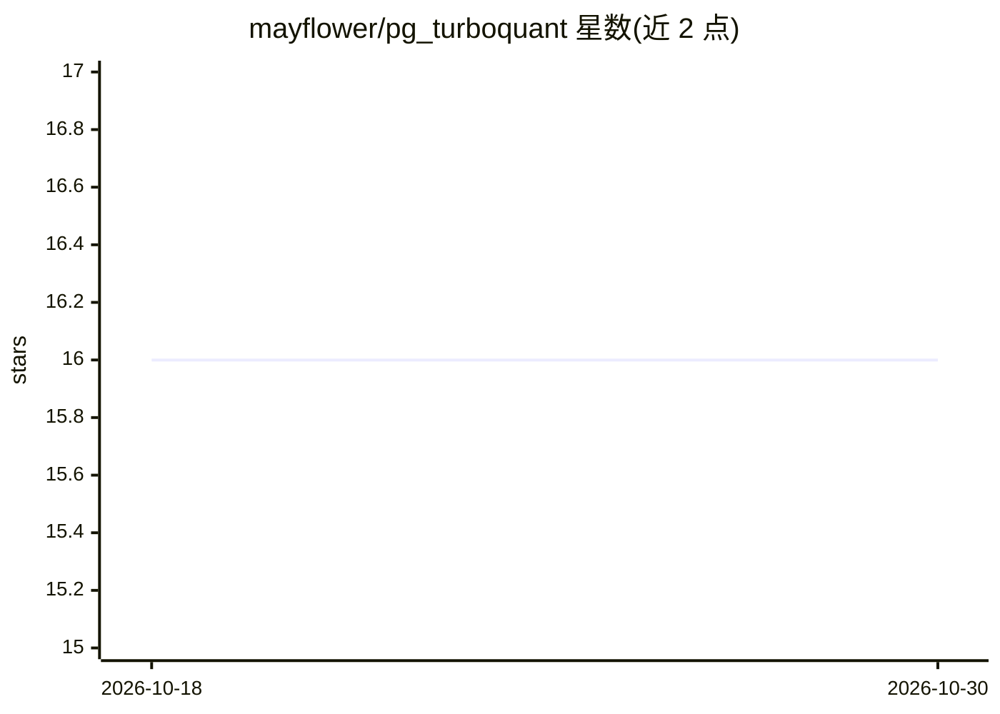

# mayflower/pg_turboquant

⭐ 16 · C · MIT · 推送 2026-09-03 · [GitHub](https://github.com/mayflower/pg_turboquant) · 组织维护

**PostgreSQL 扩展：面向 pgvector 的紧凑 ANN 索引访问方法**

为 PostgreSQL 16/17 提供自定义索引访问方法 turboquant，在 vector/halfvec 上做紧凑近似最近邻检索。核心机制：paper-faithful TurboQuant v2 量化 payload、SoA 批处理页 4-bit 打包 nibble 实现 zero-copy SIMD 评分、NEON TBL 与 AVX2 VPSHUFB block-16 内核；支持 cosine/IP/L2（L2 与非归一化走兼容回退路径）、flat/IVF 扫描与 bitmap 过滤、SQL 侧精确重排函数。依赖 pgvector（CI 锚定 v0.8.1），通过 PGXS 源码编译安装；v2 为格式升级，旧索引需 REINDEX 重建。

## 筛选速览

| 维度 | 判定 | 备注 |
|---|---|---|
| AI 角色 | `ai-ecosystem` | LLM/agent 周边工具 |
| 许可风险 | `permissive` | MIT |
| 部署形态 | `None` |  |
| 模型依赖 | — | README 未给出锁定关系 |
| 硬件要求 | — | 无带数字的原话,不猜 |
| 安装摩擦 | `medium` | 含编译或系统依赖之一 |
| 成熟度 | — | 结构信号不足 |

## 能力要点

- SoA 4-bit 打包页格式支持 NEON/AVX2 SIMD 零拷贝评分内核
- 支持 flat/IVF 扫描、bitmap 过滤与最多八个固定宽度元数据/负载列
- SQL 辅助函数：rerank、approx_candidates、maintain_index、last_scan_stats 等
- 带可复现基准测试套件与 RAG 评测 harness（微基准回归门槛）

## 适用场景

- 已在 pgvector 中存储 embedding、需要更小索引体积的 PostgreSQL 用户
- 谓词过滤密集的向量检索工作负载
- RAG 检索阶段的库内 ANN 索引与精确重排

## 场景标签

`向量数据库` · 领域:知识与检索

## 证据(README 行号)

> L3: `pg_turboquant` is a PostgreSQL extension that adds a custom ANN index access method, `turboquant`, for compact near
> L9: - PostgreSQL users already storing embeddings with pgvector often want a denser index format.

## 星数曲线

2026-10-18 16 → 2026-10-30 16（+0）

---
*卡片 v1 · prompt 1.4 · 生成 2026-10-30 · 置信度 high · 依据 README sha `d775da9e3f33` · [字段定义](../../DATASET.md)*
