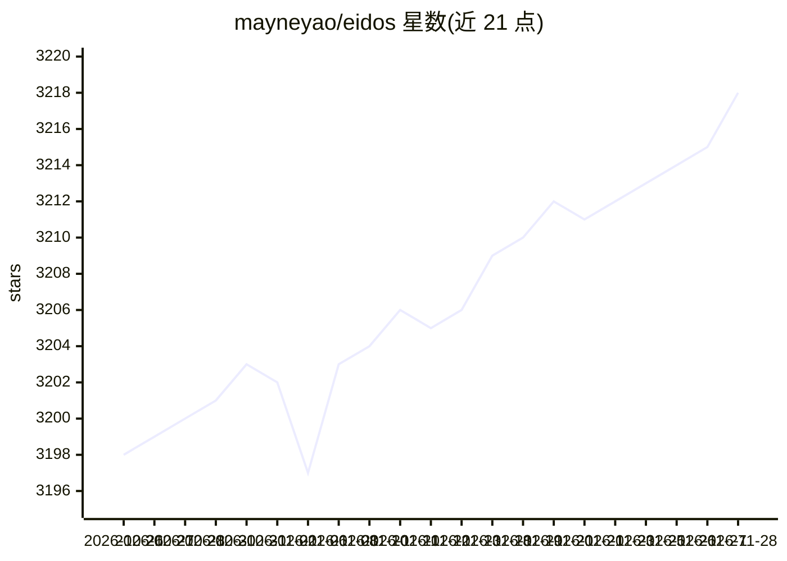

# mayneyao/eidos

⭐ 3,218 · TypeScript · AGPL-3.0 · 推送 2026-11-27 · [GitHub](https://github.com/mayneyao/eidos) · [官网](https://eidos.space) · 个人维护 · 中文 README

**本地优先的单文件关系型表格，供个人与 agent 共用**

Eidos 是一个基于标准 SQLite 的开放单文件格式（Eidos File），配套桌面应用 Eidos Lite、Android/iOS 应用、浏览器编辑器与 CLI，用于在本地文件夹中管理表格记录与 Markdown 编辑。本地使用无需账号，可离线工作，桌面与移动端可在局域网内配对同步。CLI 定位为 agent 优先的入口，支持创建、检查、查询、更新并通过本地服务器提供 Eidos File，README 提及配套的 agent 与自动化工作流指南。仓库采用 AGPL v3 许可。

## 筛选速览

| 维度 | 判定 | 备注 |
|---|---|---|
| AI 角色 | `ai-enhanced` | 去掉 AI 部分产品仍成立 |
| 许可风险 | `viral` | AGPL-3.0 |
| 部署形态 | `library` | 以包/库形式分发 |
| 模型依赖 | — | README 未给出锁定关系 |
| 硬件要求 | — | 无带数字的原话,不猜 |
| 安装摩擦 | `low` | 无编译、无系统依赖或容器化 |
| 成熟度 | — | 结构信号不足 |

## 能力要点

- 单文件格式基于标准 SQLite，可离线使用且无需账号
- 提供桌面、Android/iOS、浏览器编辑器与 CLI 多种运行形态
- CLI 面向 agent 与自动化场景，支持创建、查询、更新与本地 serve
- Graft 提供本地版本历史与可选同步

## 适用场景

- 在本地管理个人结构化数据与 Markdown 笔记
- 让 agent 通过 CLI 读写和查询我的数据文件
- 手机与桌面之间在局域网内同步本地数据

## 场景标签

`知识库管理` · 领域:知识与检索

## 证据(README 行号)

> L3:  A single-file relational spreadsheet, for you and your agent.
> L5:  Eidos File is an open, single-file format built on standard SQLite.
> L83: - `apps/cli` contains the agent-first CLI and local server.

## 星数曲线

2026-10-26 3,198 → 2026-11-28 3,218（+20）

---
*卡片 v1 · prompt 1.4 · 生成 2026-11-24 · 置信度 low · 依据 README sha `00fb016ce04a` · [字段定义](../../DATASET.md)*
