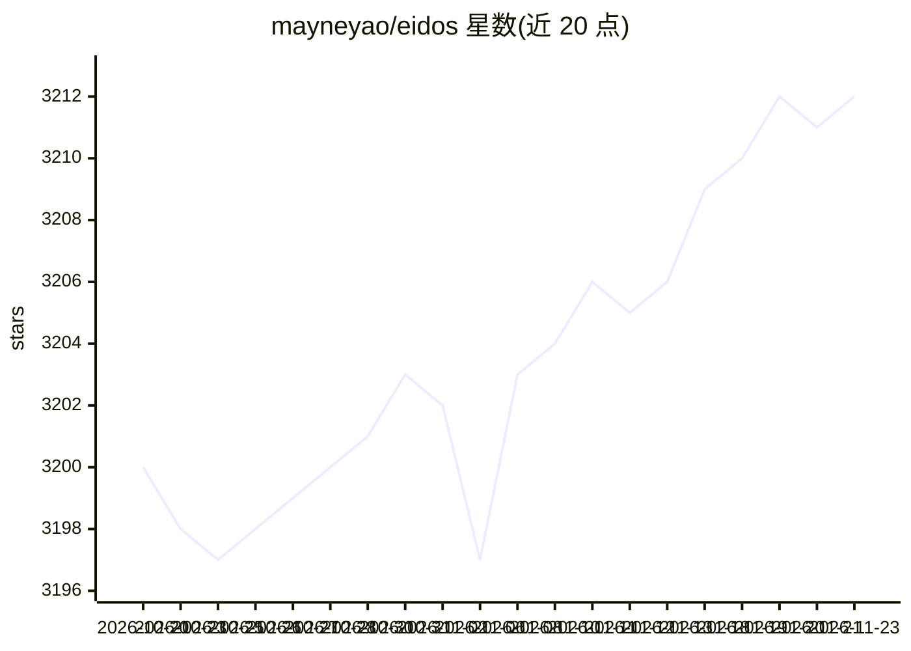

# mayneyao/eidos

⭐ 3,212 · TypeScript · AGPL-3.0 · 推送 2026-11-22 · [GitHub](https://github.com/mayneyao/eidos) · [官网](https://eidos.space) · 组织维护 · 中文 README

**本地优先的单文件关系型表格数据库，供用户与 agent 使用**

Eidos 以标准 SQLite 为基础定义单文件格式（Eidos File），并提供桌面应用 Eidos Lite、Android/iOS 移动端、浏览器编辑器与 CLI 多种入口；支持 Markdown 编辑、表格与记录管理、本地文件夹工作、离线使用、局域网同步与版本历史（基于 Graft）。CLI 可创建、检查、查询、更新并以本地服务器方式提供 Eidos Files，文档指出其面向 agent 与自动化工作流。仓库采用 AGPL v3 许可，桌面与 Android 提供安装包，iOS 为实验性、需从源码构建。

## 筛选速览

| 维度 | 判定 | 备注 |
|---|---|---|
| AI 角色 | `ai-enhanced` | 去掉 AI 部分产品仍成立 |
| 许可风险 | `viral` | AGPL-3.0 |
| 部署形态 | `library` | 以包/库形式分发 |
| 模型依赖 | — | README 未给出锁定关系 |
| 硬件要求 | — | 无带数字的原话,不猜 |
| 安装摩擦 | `low` | 无编译、无系统依赖或容器化 |
| 成熟度 | — | 结构信号不足 |

## 能力要点

- 基于标准 SQLite 的开放单文件格式（Eidos File）
- 桌面/Android/iOS/浏览器/CLI 五种访问方式，本地使用无需账号
- CLI 支持 create/inspect/query/update/serve 与 agent 自动化工作流
- 基于 Graft 的本地版本历史与可选局域网同步

## 适用场景

- 本地离线管理结构化表格与 Markdown 笔记
- 让 agent 通过 CLI 创建、查询和更新数据文件
- 手机与桌面在同一局域网内同步本地 Space

## 场景标签

`知识库管理` · 领域:知识与检索

## 证据(README 行号)

> L3:  A single-file relational spreadsheet, for you and your agent.
> L37: - **CLI:** Install `eidos` to create, inspect, query, update, and serve Eidos Files.
> L61: See the Eidos CLI guide for agent and automation workflows.

## 星数曲线

2026-10-20 3,200 → 2026-11-23 3,212（+12）

---
*卡片 v1 · prompt 1.4 · 生成 2026-11-23 · 置信度 mid · 依据 README sha `4d736c13960e` · [字段定义](../../DATASET.md)*
