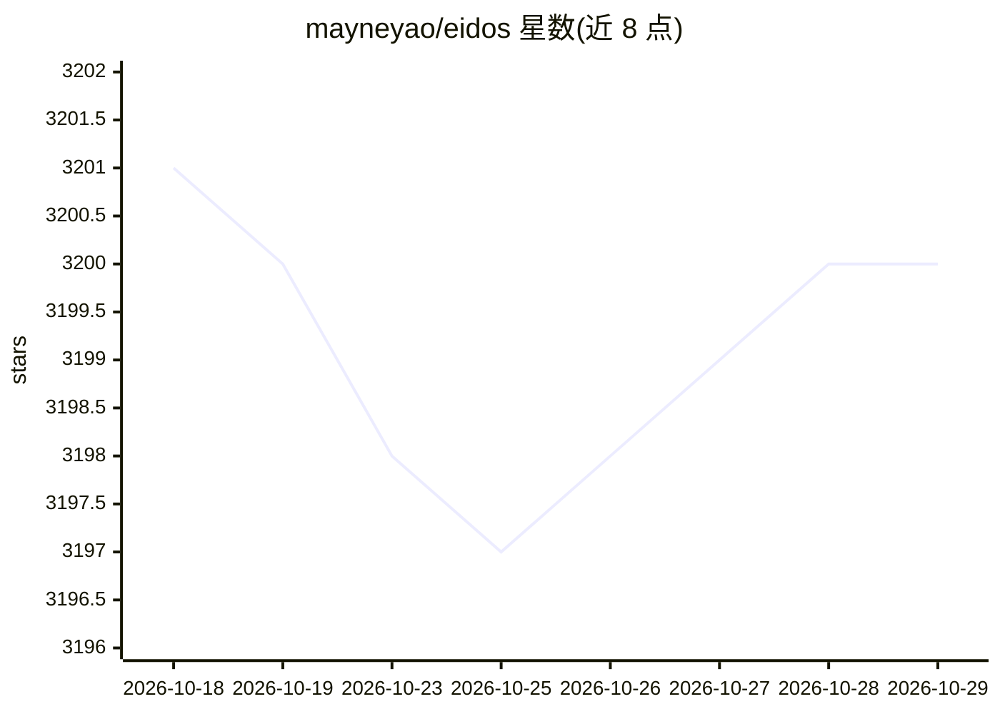

# mayneyao/eidos

⭐ 3,200 · TypeScript · AGPL-3.0 · 推送 2026-10-27 · [GitHub](https://github.com/mayneyao/eidos) · [官网](https://eidos.space) · 个人维护

**面向用户与 AI agent 的单文件关系型电子表格**

Eidos 定义了基于标准 SQLite 的开放单文件格式 Eidos File，并配套多端应用：桌面端 Eidos Lite 操作本地文件夹与 Eidos 文件，Android/iOS 应用提供离线浏览与 Markdown 编辑，浏览器版免安装编辑 .eidos 文件，另有 agent 优先的 CLI 负责创建、查询与本地服务。CLI 支持 macOS/Linux/Windows 脚本安装，桌面与 Android 提供下载安装包，iOS 需从源码构建（标注 experimental）。仓库含 TypeScript 共享包与私有 Rust crate 工作区，AGPL v3 许可。

## 筛选速览

| 维度 | 判定 | 备注 |
|---|---|---|
| AI 角色 | `ai-enhanced` | 去掉 AI 部分产品仍成立 |
| 许可风险 | `viral` | AGPL-3.0 |
| 部署形态 | `library` | 以包/库形式分发 |
| 模型依赖 | — | README 未给出锁定关系 |
| 硬件要求 | — | 无带数字的原话,不猜 |
| 安装摩擦 | `low` | 无编译、无系统依赖或容器化 |
| 成熟度 | — | 结构信号不足 |

## 能力要点

- 基于标准 SQLite 的单文件开放格式 Eidos File
- 桌面/Android/iOS/浏览器/CLI 多端应用，本地使用无需账号
- agent 优先的 CLI：创建、查询、更新与本地服务 Eidos 文件
- 使用 Graft 做本地版本历史与可选同步

## 适用场景

- 在本地单文件中管理结构化数据表，无需账号
- 让 AI agent 通过 CLI 读写和查询 Eidos 文件
- 在手机上离线编辑 Markdown 与表格并通过局域网同步

## 场景标签

`知识库管理` · 领域:知识与检索

## 证据(README 行号)

> L3:  A single-file relational spreadsheet, for you and your agent.
> L81: - `apps/cli` contains the agent-first CLI and local server.

## 星数曲线

2026-10-18 3,201 → 2026-10-29 3,200（-1）

---
*卡片 v1 · prompt 1.4 · 生成 2026-10-20 · 置信度 low · 依据 README sha `f6c2ac65b525` · [字段定义](../../DATASET.md)*
