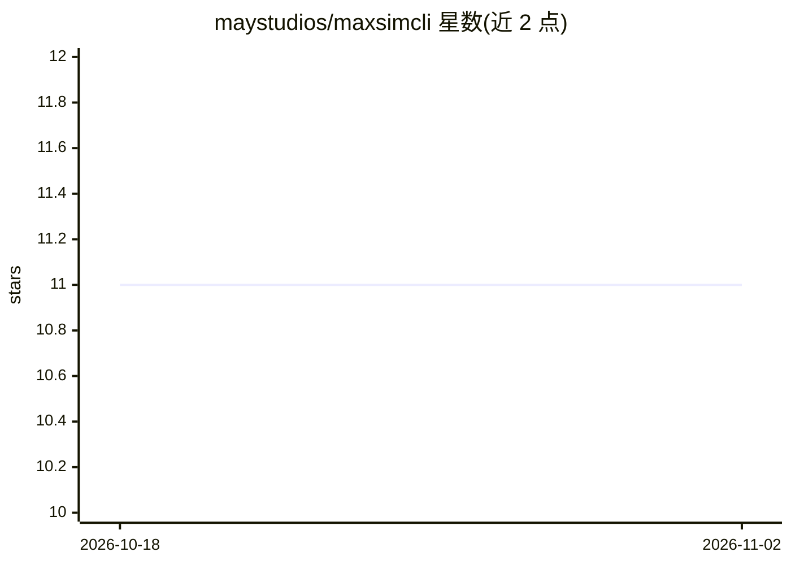

# maystudios/maxsimcli

⭐ 11 · TypeScript · NOASSERTION · 推送 2026-04-05 · [GitHub](https://github.com/maystudios/maxsimcli) · 组织维护

**面向 Claude Code 的元提示与项目编排系统：对抗上下文衰减**

以 npm CLI 安装到项目 .claude/ 目录，向 Claude Code 提供 14 个斜杠命令、4 个角色 agent（executor/planner/researcher/verifier）、15 个技能与 18 个工作流文件。它不直接调用 LLM API，而是通过 markdown 提示与工作流编排 Claude Code 子代理：任务分阶段规划、每个任务在全新 agent 中执行、原子提交，GitHub Issues/Project Board 作为唯一事实来源，独立计划以 git worktree 分波并行。需 Node.js 22+、Claude Code、Git 与 GitHub CLI；v6 仅支持 Claude Code。部分 github 子命令为 planned 状态。

## 筛选速览

| 维度 | 判定 | 备注 |
|---|---|---|
| AI 角色 | `ai-ecosystem` | LLM/agent 周边工具 |
| 许可风险 | `none` | NOASSERTION |
| 部署形态 | `library` | 以包/库形式分发 |
| 模型依赖 | — | README 未给出锁定关系 |
| 硬件要求 | — | 无带数字的原话,不猜 |
| 安装摩擦 | `low` | 无编译、无系统依赖或容器化 |
| 成熟度 | — | 结构信号不足 |

## 能力要点

- 14 个斜杠命令、4 个角色 agent、15 技能、18 工作流，npx 一条命令安装
- GitHub Issues/Project Board 作为项目状态唯一事实来源
- git worktree 分波并行执行独立计划，每任务新 agent 隔离上下文
- 3 档模型配置（quality/balanced/budget）控制各 agent 使用的模型层级

## 适用场景

- 大型项目中让 Claude Code 分阶段规划与执行开发任务，避免上下文丢失
- 通过 GitHub Issue 与看板跟踪 AI 编排的开发进度
- 并行运行多个独立开发任务并自动验证（测试/构建/lint/代码审查门禁）

## 场景标签

`编码 Agent` · 领域:编码与开发

## 证据(README 行号)

> L23: It does not call any LLM API directly. MAXSIM orchestrates Claude Code agents through markdown prompts and workflow
> L3: Meta-prompting and project orchestration system for Claude Code.

## 星数曲线

2026-10-18 11 → 2026-11-02 11（+0）

---
*卡片 v1 · prompt 1.4 · 生成 2026-11-02 · 置信度 high · 依据 README sha `02275978def2` · [字段定义](../../DATASET.md)*
