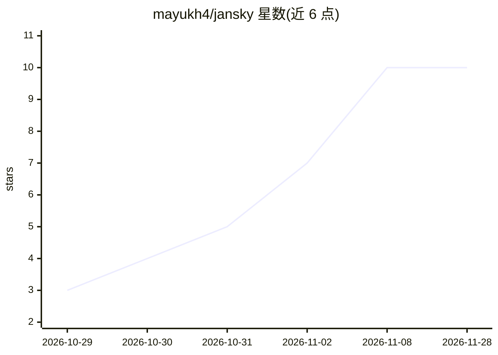

# mayukh4/jansky

⭐ 10 · Python · MIT · 推送 2026-10-26 · [GitHub](https://github.com/mayukh4/jansky) · 个人维护

**树莓派 5 上离线运行的常驻语音 AI 助手**

Jansky 是运行在 Raspberry Pi 5 + AI HAT+ 2（Hailo-10H）上的语音助手：唤醒词 "Hey Jansky" 触发，语音识别（Whisper Small）、LLM（Qwen3 1.7B）与语音合成均在本地运行，语音数据不离开设备。支持通过 Home Assistant 控制灯具/风扇、列表与提醒、计时器、天气新闻查询与文本记忆（纯文本文件）。提供一键安装脚本，下载约 4 GB 模型。限制包括 2,048 token 上下文与家庭控制仅开关量。

## 筛选速览

| 维度 | 判定 | 备注 |
|---|---|---|
| AI 角色 | `ai-native` | 本体是模型或模型工具 |
| 许可风险 | `permissive` | MIT |
| 部署形态 | `None` |  |
| 模型依赖 | — | README 未给出锁定关系 |
| 硬件要求 | — | 无带数字的原话,不猜 |
| 安装摩擦 | `low` | 无编译、无系统依赖或容器化 |
| 成熟度 | — | 结构信号不足 |

## 能力要点

- 唤醒词、语音识别、LLM、语音全部在树莓派本地运行，语音不上传
- Qwen3 1.7B 部署于 AI HAT+ 2 的 Hailo-10H 上
- 通过 Home Assistant 控制灯/风扇/开关
- 一键安装脚本，重复运行可跳过已完成步骤

## 适用场景

- 在桌面搭建一个不上云的私人语音助手
- 用语音控制家中的灯、风扇等 Home Assistant 设备
- 完全离线环境下使用语音问答与提醒功能

## 场景标签

`语音 Agent` `AI 助手` · 领域:对话与助手

## 证据(README 行号)

> L3: Say "Hey Jansky" and talk. It answers, switches your lights and fan, keeps your list, sets timers and remembers
> L4: you. The model, the speech recognition and the voice all run on the Pi. No subscription, no account, and your
> L18: - **Brain:** Qwen3 1.7B on the AI HAT+ 2. Vague requests ("it's hot in here") turn into actions (fan on).

## 星数曲线

2026-10-29 3 → 2026-11-28 10（+7）

---
*卡片 v1 · prompt 1.4 · 生成 2026-11-19 · 置信度 high · 依据 README sha `ceca57581c1a` · [字段定义](../../DATASET.md)*
