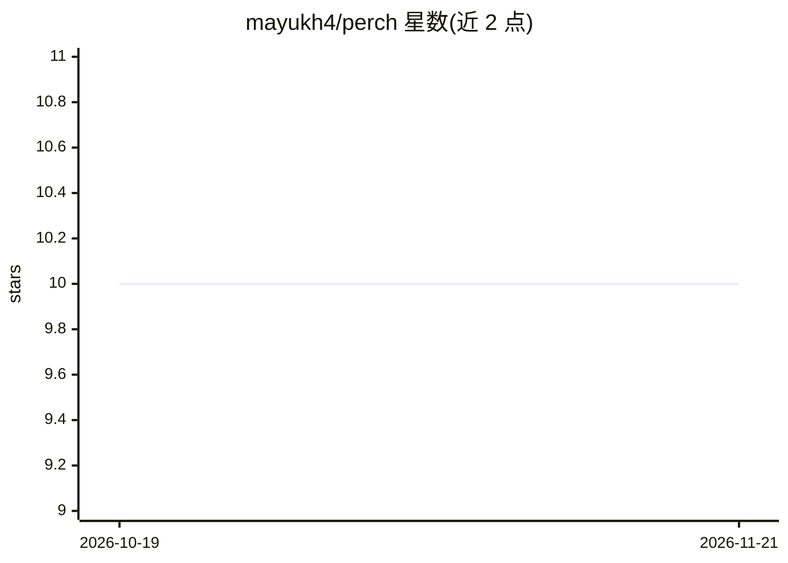

# mayukh4/perch

⭐ 10 · TypeScript · MIT · 推送 2026-08-27 · [GitHub](https://github.com/mayukh4/perch) · [官网](https://perchondesk.com) · 个人维护

**树莓派桌面仪表盘：小组件、触摸屏与可接任意 AI 的语音按钮**

运行在 Raspberry Pi 5 与 7 英寸触摸屏上的桌面仪表盘，也支持其他 Linux 开发板。提供小组件网格（时钟、天气、新闻、Home Assistant、Stripe、YouTube、自定义 URL 等 8 种）、手机/笔记本上的拖拽配置控制台，以及一个语音按钮：转录与回答模型分离设置，可指向 OpenAI、Anthropic、Groq、Ollama、LM Studio、webhook 或已有 agent，其中 0.6B 模型可在 Pi 本地运行。无账号、无云依赖、仅限 LAN 访问；需 Node 22+ 与约 1.5 GB 空间。

## 筛选速览

| 维度 | 判定 | 备注 |
|---|---|---|
| AI 角色 | `ai-enhanced` | 去掉 AI 部分产品仍成立 |
| 许可风险 | `permissive` | MIT |
| 部署形态 | `None` |  |
| 模型依赖 | — | README 未给出锁定关系 |
| 硬件要求 | — | 无带数字的原话,不猜 |
| 安装摩擦 | `low` | 无编译、无系统依赖或容器化 |
| 成熟度 | — | 结构信号不足 |

## 能力要点

- 语音按钮可指向任意 AI 端点，包括完全在 Pi 本地运行的模型
- 通过手机/笔记本拖拽小组件，桌面屏幕实时跟随（WebSocket）
- 小组件为一个文件夹（manifest + 组件 + 约 40 行），支持 agent 代写
- 时钟/天气/新闻开箱即用，无需密钥与账号

## 适用场景

- 在工位上一眼查看时钟、天气、新闻与家庭状态
- 按一下按钮对本地运行的 AI 说话并显示回答
- 通过 Home Assistant 小组件展示家中信息
- 自己写小组件放到桌面屏幕上

## 场景标签

`AI 助手` `语音 Agent` · 领域:对话与助手

## 证据(README 行号)

> L34: - **A widget grid**, on a screen with no notifications, no browser and no feed
> L35: - **A talk button** that reaches your endpoint — OpenAI, Anthropic, Groq,
> L36:  Ollama, LM Studio, a webhook, or an agent with a command line
> L201: An 0.6B model on the Pi itself answers that in about nine seconds, with

## 星数曲线

2026-10-19 10 → 2026-11-21 10（+0）

---
*卡片 v1 · prompt 1.4 · 生成 2026-11-19 · 置信度 high · 依据 README sha `a28cc12d340a` · [字段定义](../../DATASET.md)*
