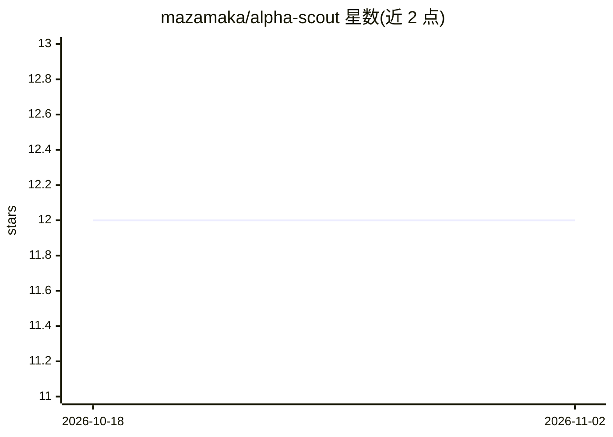

# mazamaka/alpha-scout

⭐ 12 · Python · MIT · 推送 2026-10-03 · [GitHub](https://github.com/mazamaka/alpha-scout) · 个人维护

**交易与市场情报收集器：多源抓取、LLM 筛选、Telegram 告警**

面向交易与市场研究者的自动化情报管道：从 Reddit、GitHub、Hacker News、Polymarket、RSS 及 X（会话式抓取，带新闻回退）异步采集内容，经内容哈希去重后由 Claude Code CLI 执行两阶段分析——先筛选再做深度评估，按可配置权重与阈值打分，高分结果发送至 Telegram，FastAPI 仪表盘可浏览想法与采集器状态。要求 Python 3.12+ 与已认证的 Claude Code CLI，支持本地或 Docker 部署；采集按计划调度而非实时，且明确声明不执行交易、LLM 分数仅为研究过滤而非实测收益。

## 筛选速览

| 维度 | 判定 | 备注 |
|---|---|---|
| AI 角色 | `ai-native` | 本体是模型或模型工具 |
| 许可风险 | `permissive` | MIT |
| 部署形态 | `library` | 以包/库形式分发 |
| 模型依赖 | — | README 未给出锁定关系 |
| 硬件要求 | — | 无带数字的原话,不猜 |
| 安装摩擦 | `low` | 无编译、无系统依赖或容器化 |
| 成熟度 | — | 结构信号不足 |

## 能力要点

- Reddit/GitHub/HN/Polymarket/RSS/X 多源异步采集，各自独立调度
- 内容哈希去重与 JSON 存储
- 经 Claude Code CLI 的两阶段 LLM 筛选与深度分析，可配置权重与告警阈值
- Telegram 告警与 FastAPI Web 仪表盘

## 适用场景

- 自动汇集交易与市场研究线索并过滤低价值内容
- 接收高分想法的 Telegram 推送
- 在仪表盘中查看候选想法与各采集器运行状态

## 场景标签

`网页抓取` `金融量化` · 领域:效率与自动化

## 证据(README 行号)

> L3: **Collect trading and market-research ideas, filter them with an LLM, and send the useful ones to Telegram.**
> L10: - 🧠 **Two-stage analysis** — a screening pass followed by deeper evaluation through Claude Code CLI.

## 星数曲线

2026-10-18 12 → 2026-11-02 12（+0）

---
*卡片 v1 · prompt 1.4 · 生成 2026-11-01 · 置信度 mid · 依据 README sha `fc556c2b7dda` · [字段定义](../../DATASET.md)*
