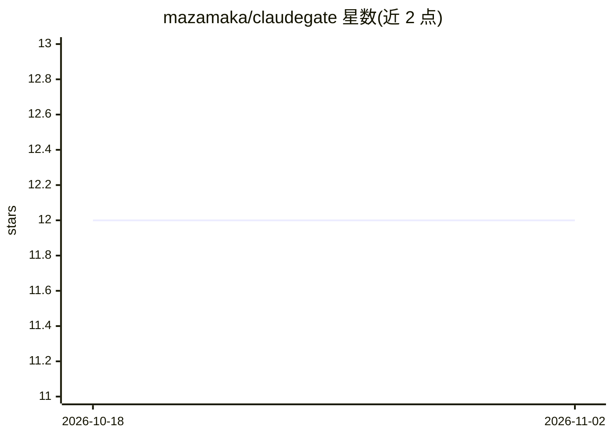

# mazamaka/claudegate

⭐ 12 · Python · MIT · 推送 2026-10-13 · [GitHub](https://github.com/mazamaka/claudegate) · 个人维护

**把 Claude Code CLI 封装成 OpenAI 兼容 API 的网关服务**

基于 FastAPI 与 Claude Agent SDK 的代理服务，将已安装并认证的 Claude Code CLI 暴露为 OpenAI 兼容的 chat completions API，支持流式输出、工具调用、图像与 PDF 输入、跨请求的会话复用，以及 effort 控制、模型发现、健康探针与 Prometheus 指标。面向希望用 Hermes Agent、OpenClaw 等 OpenAI 兼容客户端接入 Claude Code 的开发者。要求 Python 3.10+ 与 PATH 上的 Claude Code CLI；CLI 默认绕过权限，非回环绑定需设置 API key，部分采样参数被忽略、n>1 被拒绝。

## 筛选速览

| 维度 | 判定 | 备注 |
|---|---|---|
| AI 角色 | `ai-ecosystem` | LLM/agent 周边工具 |
| 许可风险 | `permissive` | MIT |
| 部署形态 | `library` | 以包/库形式分发 |
| 模型依赖 | locked-api |  |
| 硬件要求 | — | 无带数字的原话,不猜 |
| 安装摩擦 | `low` | 无编译、无系统依赖或容器化 |
| 成熟度 | — | 结构信号不足 |

## 能力要点

- OpenAI 兼容 chat completions API，含流式与 usage 报告
- 工具调用与会话复用：续接请求匹配存活会话，会话丢失时从请求历史重建
- 图像/PDF/文本附件输入与 effort 别名控制
- 模型发现、健康探针、Prometheus 指标与部署 smoke 检查；自带 fake CLI 测试套件，无需 Claude 凭证

## 适用场景

- 让 Hermes Agent / OpenClaw 等 OpenAI 兼容客户端使用 Claude Code 作为模型后端
- 把 Claude Code 接入只支持 OpenAI API 格式的现有工具链
- 通过本地端点对 Claude Code 会话做统一鉴权与会话隔离

## 场景标签

`模型网关` · 领域:Agent 开发

## 证据(README 行号)

> L3: **Use the Claude Code CLI through an OpenAI-compatible chat API.**
> L18: - **FastAPI + Claude Agent SDK**, with an OpenAI-compatible request/response layer.

## 星数曲线

2026-10-18 12 → 2026-11-02 12（+0）

---
*卡片 v1 · prompt 1.4 · 生成 2026-11-01 · 置信度 mid · 依据 README sha `46a901a8caa4` · [字段定义](../../DATASET.md)*
