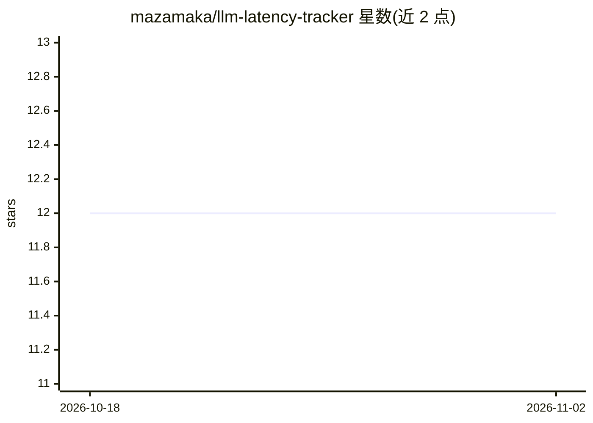

# mazamaka/llm-latency-tracker

⭐ 12 · Python · MIT · 推送 2026-11-01 · [GitHub](https://github.com/mazamaka/llm-latency-tracker) · [官网](https://llmlatency.dev) · 个人维护

**多区域 AI API 延迟与可用性测量：开放数据+JSON API+MCP**

从分布式探针节点测量 46 家 AI 推理服务在不同区域的响应时间与可用性，区分网络层 TTFB 与推理 TTFT 两种探测，发布每日排行、历史快照与 p50/p95 统计。数据以 CC-BY-4.0 开放，发布到 Zenodo（DOI）、Hugging Face、Kaggle，并提供 JSON API、stdio MCP 服务器（get_ai_api_latency 等只读工具）、llms.txt 索引与模型下线日历。边缘探针仅用 Python 标准库即可本地运行；推理探测需各服务商 API key，SQLite 存储、静态发布。

## 筛选速览

| 维度 | 判定 | 备注 |
|---|---|---|
| AI 角色 | `ai-ecosystem` | LLM/agent 周边工具 |
| 许可风险 | `permissive` | MIT |
| 部署形态 | `library` | 以包/库形式分发 |
| 模型依赖 | — | README 未给出锁定关系 |
| 硬件要求 | — | 无带数字的原话,不猜 |
| 安装摩擦 | `low` | 无编译、无系统依赖或容器化 |
| 成熟度 | — | 结构信号不足 |

## 能力要点

- 边缘 TTFB 与推理 TTFT 分开测量并单独报告
- 46 家服务商、4 区域的每日排行与 p50/p95、可用率统计
- stdlib MCP 服务器提供 4 个只读工具，无需 key
- 数据发布至 Zenodo/Hugging Face/Kaggle，附模型下线日历

## 适用场景

- 按区域对比 AI API 服务商的延迟与可用性选服务商
- agent 通过 MCP 或 JSON API 读取实时延迟排行
- 跟踪模型下线时间表以规划迁移

## 场景标签

 · 领域:LLM 基础设施/可观测性

## 证据(README 行号)

> L3: **Measure AI API latency and uptime across regions, and publish the results as open data.**
> L9: - 🌍 **Regional measurements** — compare provider response times and availability from distributed probe nodes.
> L11: - 📈 **Open dataset** — daily rankings, historical snapshots and regional p50 / p95 statistics.
> L12: - 🤖 **Agent access** — JSON API, MCP, Markdown pages and an `llms.txt` index.

## 星数曲线

2026-10-18 12 → 2026-11-02 12（+0）

---
*卡片 v1 · prompt 1.4 · 生成 2026-11-01 · 置信度 mid · 依据 README sha `0ffdcffe5a0c` · [字段定义](../../DATASET.md)*
