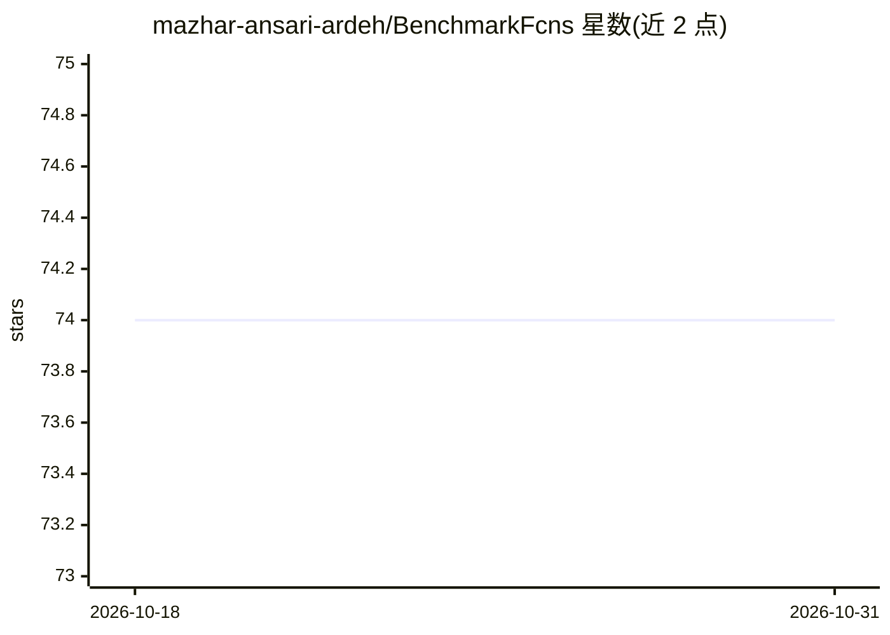

# mazhar-ansari-ardeh/BenchmarkFcns

⭐ 74 · C++ · MIT · 推送 2026-05-21 · [GitHub](https://github.com/mazhar-ansari-ardeh/BenchmarkFcns) · [官网](https://benchmarkfcns.info/) · 个人维护

**优化算法基准测试函数库：310+ 数学目标函数的 Python/MATLAB 实现**

面向全局优化与强化学习社区的性能测试函数库：以 C++17 核心（Eigen、OpenMP、SIMD）实现 310+ 数学目标函数，内置 CEC 2005-2022 竞赛套件（含嵌入的 shift/rotation/shuffle 数据）、多保真与多目标套件，并提供 Gymnasium 环境封装与 SciPy、Nevergrad、Optuna、PyMOO、CMA-ES 的集成示例。输入为矩阵（行=数据点，列=维度），通过 OMP_NUM_THREADS 控制并行线程数。经 PyPI 以 pip 安装，MATLAB 版通过 addpath 使用，本地编译需 CMake≥3.15。

## 筛选速览

| 维度 | 判定 | 备注 |
|---|---|---|
| AI 角色 | `ai-ecosystem` | LLM/agent 周边工具 |
| 许可风险 | `permissive` | MIT |
| 部署形态 | `library` | 以包/库形式分发 |
| 模型依赖 | — | README 未给出锁定关系 |
| 硬件要求 | — | 无带数字的原话,不猜 |
| 安装摩擦 | `medium` | 含编译或系统依赖之一 |
| 成熟度 | — | 结构信号不足 |

## 能力要点

- 310+ 函数：经典 100+、多保真 49、多目标 50（WFG/MaF/UF/CF）
- 内置 CEC 2005-2022 官方竞赛套件数据
- C++17 核心 + OpenMP/SIMD，批量评估多核并行
- Gymnasium (OpenAI Gym) 环境封装用于 RL 训练

## 适用场景

- 为优化算法实验提供标准基准测试函数
- 用高性能批量评估加速进化算法与超参优化
- 以 Gymnasium 环境训练 RL agent 求解数学景观
- 绘制基准函数的三维/多保真可视化

## 场景标签

 · 领域:优化算法/科学计算

## 证据(README 行号)

> L7: **BenchmarkFcns** is the high-performance fitness engine for the global optimization and reinforcement learning comm
> L9: Designed for **Black-Box Optimization**, **Evolutionary Computation**, and **AI Training**, the library leverages **

## 星数曲线

2026-10-18 74 → 2026-10-31 74（+0）

---
*卡片 v1 · prompt 1.4 · 生成 2026-10-24 · 置信度 high · 依据 README sha `3752609309a5` · [字段定义](../../DATASET.md)*
