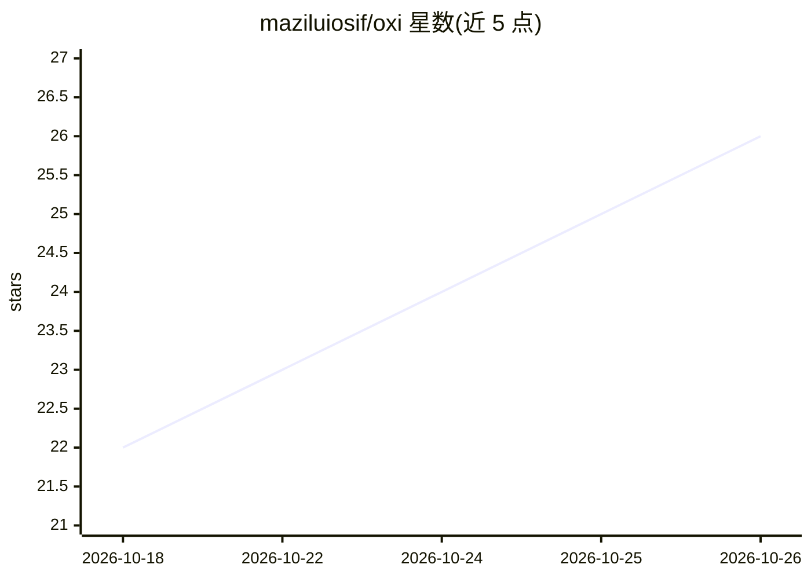

# maziluiosif/oxi

⭐ 26 · Rust · MIT · 推送 2026-10-25 · [GitHub](https://github.com/maziluiosif/oxi) · [官网](https://maziluiosif.github.io/oxi/) · 个人维护

**Rust 桌面端编程助手：多 agent 同聊切换并带上下文**

单文件 Rust 桌面应用（非 Electron），让 Claude Code、Codex、Cursor、Copilot 等订阅在同一个对话中使用，可中途切换 agent 并保留上下文。支持本地模型：下载 GGUF 并运行 llama-server（本机或 SSH 远程 GPU），也可接入 LM Studio、Ollama、llama.cpp 及 OpenAI、Azure、OpenRouter 等 API，Router 按任务选模型并在配额耗尽时切换。内置 diff 编辑器、Git 面板、/plan 计划模式、MCP 调用、Whisper 本地语音听写与 Evidence 证据核验模式。数据留在本机，密钥存系统钥匙串。

## 筛选速览

| 维度 | 判定 | 备注 |
|---|---|---|
| AI 角色 | `ai-ecosystem` | LLM/agent 周边工具 |
| 许可风险 | `permissive` | MIT |
| 部署形态 | `None` |  |
| 模型依赖 | local-ok | 支持本地模型 |
| 硬件要求 | — | 无带数字的原话,不猜 |
| 安装摩擦 | `medium` | 含编译或系统依赖之一 |
| 成熟度 | — | 结构信号不足 |

## 能力要点

- 多 agent 同聊切换且上下文跟随（ACP 接入订阅型 agent）
- 本地模型一键安装：下载 GGUF 并运行 llama-server（支持 SSH 远程）
- Router 按任务选 provider，配额耗尽自动切换
- Evidence 模式记录前后截图与检查结果，标记缺失或矛盾声明

## 适用场景

- 在一个对话里用多个已订阅的编程 agent 协作完成任务
- 在本地或 SSH 远程机器上运行开源模型做编程助手
- 在桌面应用里完成代码编辑、Git 提交与计划驱动开发

## 场景标签

`编码 Agent` `AI 助手` · 领域:编码与开发

## 证据(README 行号)

> L3:  Your Claude Code, Codex and Cursor subscriptions in one conversation.
> L98:  Local models, set up for you. Pick a GGUF from HuggingFace and oxi installs <code>llama-server</code>, downloads i
> L144: |**LM Studio, Ollama, llama.cpp**|Your own local or LAN server, optionally over SSH|

## 星数曲线

2026-10-18 22 → 2026-10-26 26（+4）

---
*卡片 v1 · prompt 1.4 · 生成 2026-10-26 · 置信度 high · 依据 README sha `92920ccd17a4` · [字段定义](../../DATASET.md)*
