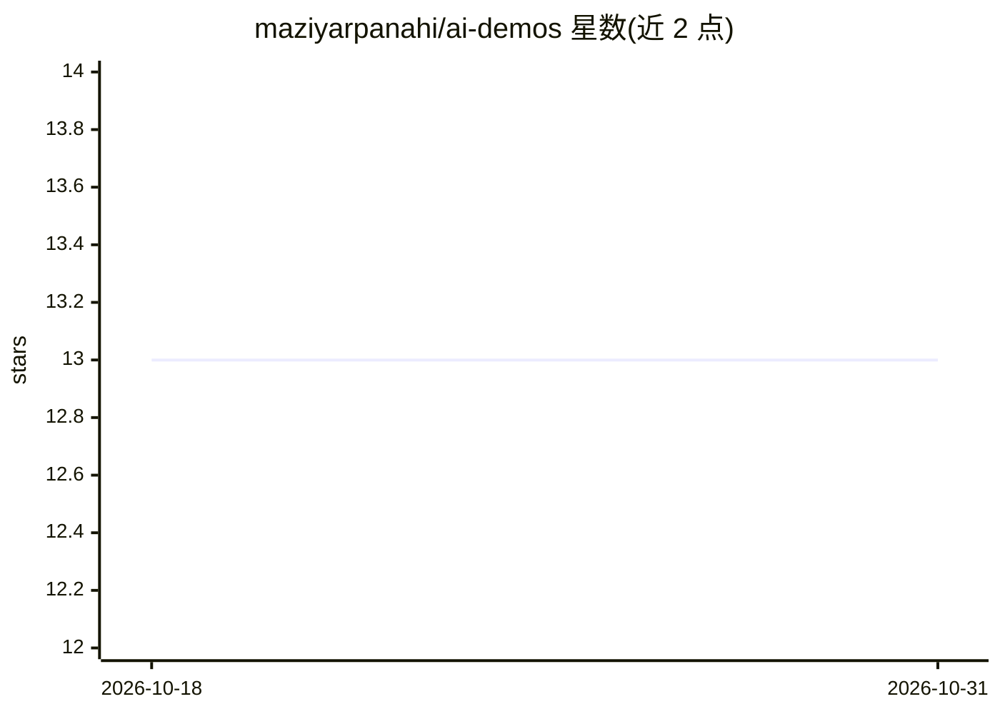

# maziyarpanahi/ai-demos

⭐ 13 · Python · MIT · 推送 2026-08-18 · [GitHub](https://github.com/maziyarpanahi/ai-demos) · 个人维护

**可运行、可改写的开源 AI 示例集合（视觉/多模态等）**

把社交媒体上看到的 AI 演示拆解为可理解、可复现的小型构建：每个 demo 聚焦一个想法，含 README、最小实现入口、requirements.txt 与示例素材，覆盖视觉（目标框标注、表单复选框读取）等类别，并计划扩展到音频、文档、agents、视频与文本代码。每个 demo 支持本地 OpenAI 兼容服务器或托管端点运行，强调标准接口而非厂商专属 SDK、本地/托管边界与已知限制透明。MIT 许可，通过 git clone 运行。

## 筛选速览

| 维度 | 判定 | 备注 |
|---|---|---|
| AI 角色 | `ai-knowledge` | 知识聚合/清单类 |
| 许可风险 | `permissive` | MIT |
| 部署形态 | `None` |  |
| 模型依赖 | — | README 未给出锁定关系 |
| 硬件要求 | — | 无带数字的原话,不猜 |
| 安装摩擦 | `low` | 无编译、无系统依赖或容器化 |
| 成熟度 | — | 结构信号不足 |

## 能力要点

- 每个 demo 一个目录：README + 最小实现 + requirements + 素材
- 支持本地 OpenAI 兼容服务器或托管端点，模型可替换
- 同一代码验证新模型后加入条目而非重复建行
- demo 路径按产出命名而非按厂商命名

## 适用场景

- 学习社交媒体上 AI 演示背后的实现技术
- 以最小可复现构建快速上手视觉/多模态模型
- 替换输入、修改 prompt 或换模型做二次开发

## 场景标签

`教程课程` `多模态` · 领域:学习与行业

## 证据(README 行号)

> L3: **Open-source AI demos you can understand, run, and remix.**
> L19: |Demo|Model(s)|What you build|Input → output|Run it|
> L43: Use a local OpenAI-compatible server or point the same demo at a hosted

## 星数曲线

2026-10-18 13 → 2026-10-31 13（+0）

---
*卡片 v1 · prompt 1.4 · 生成 2026-10-31 · 置信度 high · 依据 README sha `27fa57e9f3eb` · [字段定义](../../DATASET.md)*
