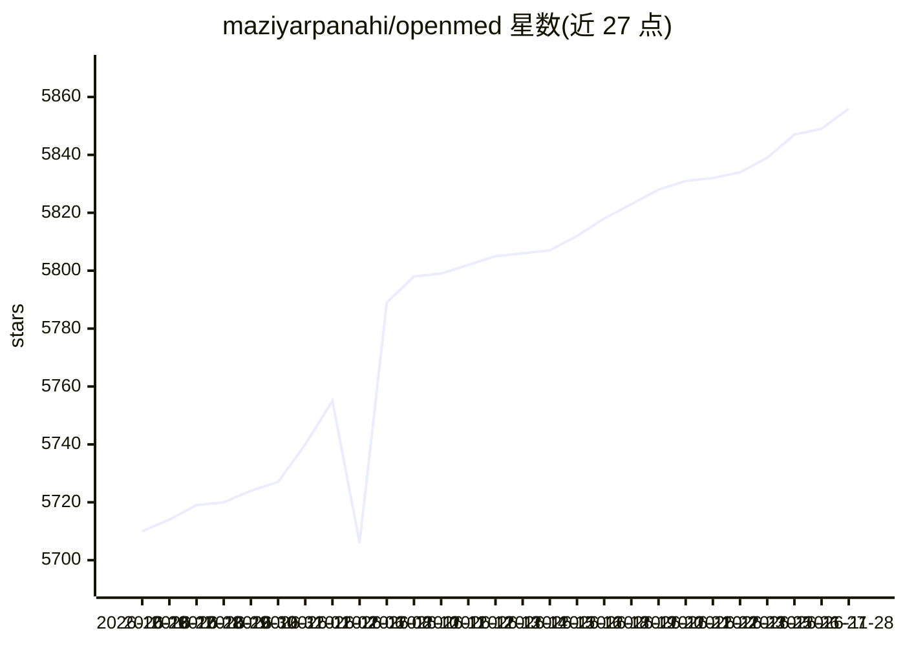

# maziyarpanahi/openmed

⭐ 5,856 · Python · Apache-2.0 · 推送 2026-11-27 · [GitHub](https://github.com/maziyarpanahi/openmed) · [官网](https://openmed.life/) · 个人维护

**本地运行的临床 NER 与 HIPAA PII 去标识化 SDK**

OpenMed 提供在本地硬件上运行的医疗文本处理 SDK：对临床文本执行医学命名实体识别与 PII 检测/去标识化，含 2,266 条模型清单条目与 35 种语言的模型驱动 PII 识别。提供 Python（PyPI）、Swift/OpenMedKit（Apple MLX）、Android/Kotlin（ONNX Runtime Mobile）、浏览器（Transformers.js）多种运行路径，以及 REST 服务与批处理接口。SDK 以 Apache-2.0 发布；模型与数据集许可各异，声明 SDK 使用本身不构成 HIPAA 合规，部署方需自行验证。

## 筛选速览

| 维度 | 判定 | 备注 |
|---|---|---|
| AI 角色 | `ai-native` | 本体是模型或模型工具 |
| 许可风险 | `permissive` | Apache-2.0 |
| 部署形态 | `self-host` | docker 或自建部署 |
| 模型依赖 | — | README 未给出锁定关系 |
| 硬件要求 | — | 无带数字的原话,不猜 |
| 安装摩擦 | `low` | 无编译、无系统依赖或容器化 |
| 成熟度 | — | 结构信号不足 |

## 能力要点

- 临床 NER 与 PII 去标识化本地运行，提供 REST/批处理接口
- 多端运行时：Python、Apple MLX/Swift、Android ONNX Runtime Mobile、浏览器 Transformers.js
- Safe Harbor 对齐的 18 类标识符配置与 HIPAA/GDPR/研究策略管线
- 离线/气隙模式：model_id 指向本地目录即可不访问 Hugging Face Hub

## 适用场景

- 在本地硬件上对临床病历做实体抽取与结构化
- 对含 PHI 的临床文档做去标识化处理
- 在 Android/iOS/浏览器端做本地 PII 识别与脱敏
- 为编码 agent 安装临床 NLP 技能构建本地管线

## 场景标签

`文档解析` · 领域:知识与检索

## 证据(README 行号)

> L5:  Turn clinical text into structured, de-identified insight on hardware you control.
> L97: - **Supported execution paths**: CPU, CUDA, MLX, mobile, service, and browser adapters vary by environment and arti

## 星数曲线

2026-10-26 5,710 → 2026-11-28 5,856（+146）

---
*卡片 v1 · prompt 1.4 · 生成 2026-11-27 · 置信度 high · 依据 README sha `68a4c5e90c41` · [字段定义](../../DATASET.md)*
