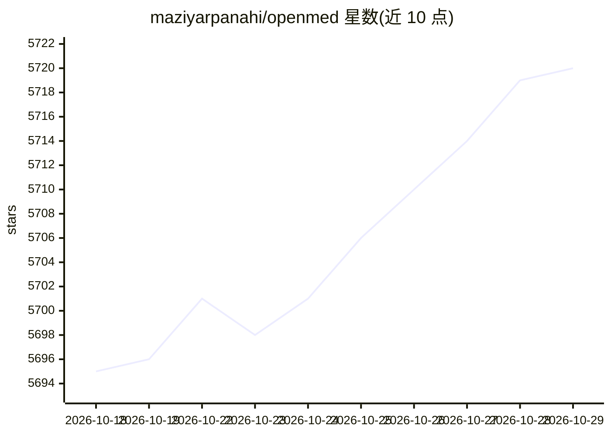

# maziyarpanahi/openmed

⭐ 5,720 · Python · Apache-2.0 · 推送 2026-10-28 · [GitHub](https://github.com/maziyarpanahi/openmed) · [官网](https://openmed.life/) · 个人维护 · 中文 README

**本地优先的医疗文本 SDK：临床 NER 与 PII 脱敏**

Apache-2.0 的 Python SDK，在本地硬件上对临床文本做命名实体识别（疾病、药物、基因、解剖等）与 PII 检测/脱敏，支持 35 种模型支持的 PII 语言与 2,266 个模型清单条目。运行时覆盖 Python（CPU/CUDA）、Apple Silicon（MLX/OpenMedKit Swift）、Android（ONNX Runtime Mobile）与浏览器（Transformers.js），并附 REST 服务、批处理、MCP server 与 agent 技能目录。核心处理在模型工件就绪后本地执行；模型下载、远程适配器与遥测路径可能联网。SDK 自身不构成 HIPAA 合规，部署方需验证模型许可与临床适用性。

## 筛选速览

| 维度 | 判定 | 备注 |
|---|---|---|
| AI 角色 | `ai-native` | 本体是模型或模型工具 |
| 许可风险 | `permissive` | Apache-2.0 |
| 部署形态 | `self-host` | docker 或自建部署 |
| 模型依赖 | — | README 未给出锁定关系 |
| 硬件要求 | `cpu-ok` | |
| 安装摩擦 | `low` | 无编译、无系统依赖或容器化 |
| 成熟度 | — | 结构信号不足 |

## 能力要点

- 临床 NER 与 PII 检测/脱敏的本地运行时，模型工件就绪后无需云端 API
- 多运行时：Python、MLX/OpenMedKit (Swift)、Android ONNX Runtime Mobile、浏览器 Transformers.js
- 策略感知流水线：HIPAA/GDPR/科研配置、签名审计报告、Faker 临床 ID 混淆
- 2,266 个模型清单条目与 35 种模型支持的 PII 语言

## 适用场景

- 在医院自有硬件上对临床文书做 PII 脱敏后再进入后续流程
- 从病历文本中抽取药物、疾病等结构化实体
- 在移动端或浏览器内运行脱敏与实体识别模型

## 场景标签

 · 领域:医疗 NLP/隐私保护

## 证据(README 行号)

> L5:  Turn clinical text into structured, de-identified insight on hardware you control.
> L55: result = analyze_text(
> L204: Rendered result: a local clinical-text pipeline that returns medical entities,

## 星数曲线

2026-10-18 5,695 → 2026-10-29 5,720（+25）

---
*卡片 v1 · prompt 1.4 · 生成 2026-10-20 · 置信度 mid · 依据 README sha `5bb1261d20fe` · [字段定义](../../DATASET.md)*
