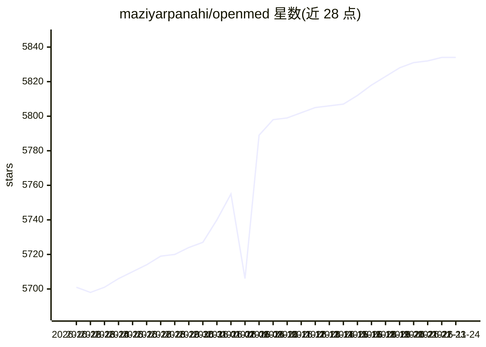

# maziyarpanahi/openmed

⭐ 5,834 · Python · Apache-2.0 · 推送 2026-11-21 · [GitHub](https://github.com/maziyarpanahi/openmed) · [官网](https://openmed.life/) · 个人维护 · 中文 README

**本地优先的医疗临床 NER 与 PII 去识别化 SDK**

OpenMed 提供 Python、Swift/OpenMedKit、Android/Kotlin 与浏览器（Transformers.js）多端运行时，在本地硬件上对临床文本执行医学实体抽取与 PII 去识别化；模型目录含 2,266 条 manifest 条目、35 种模型支持的 PII 语言。核心运行时在模型工件就绪后本地处理，下载与远程适配器走网络。SDK 以 Apache-2.0 发布，提供 REST 服务、批处理、离线加载与 Agent Skills 安装器；README 声明使用 SDK 本身不构成 HIPAA 合规，部署方需自行验证模型许可与临床适用性。

## 筛选速览

| 维度 | 判定 | 备注 |
|---|---|---|
| AI 角色 | `ai-native` | 本体是模型或模型工具 |
| 许可风险 | `permissive` | Apache-2.0 |
| 部署形态 | `self-host` | docker 或自建部署 |
| 模型依赖 | — | README 未给出锁定关系 |
| 硬件要求 | — | 无带数字的原话,不猜 |
| 安装摩擦 | `low` | 无编译、无系统依赖或容器化 |
| 成熟度 | — | 结构信号不足 |

## 能力要点

- Python/MLX/Android(ONNX Runtime Mobile)/浏览器四类运行时，本地执行 NER 与 PII 去识别化
- 2,266 条模型 manifest、35 种模型支持的 PII 语言，含疾病/药物/基因等专科模型
- REST 服务（/analyze、/pii/deidentify 等端点）、批处理与离线 air-gapped 本地目录加载
- Agent Skills 目录可装入 Claude Code、OpenAI Codex、OpenCode 及 ~/.agents/skills

## 适用场景

- 在医院本地硬件上去识别化临床病历文本再交给下游分析
- 从临床笔记抽取药物、疾病、基因等医学实体
- 移动端或浏览器内对含 PII 文档做脱敏与 token 分类
- 通过 MCP server / CLI / Agent Skills 在编码 agent 中构建本地脱敏管线

## 场景标签

`文档解析` · 领域:知识与检索

## 证据(README 行号)

> L5:  Turn clinical text into structured, de-identified insight on hardware you control.
> L20:  2,266 manifest entries &nbsp;·&nbsp; 35 model-backed PII languages &nbsp;·&nbsp; Apache-2.0 SDK
> L204: Rendered result: a local clinical-text pipeline that returns medical entities,

## 星数曲线

2026-10-22 5,701 → 2026-11-24 5,834（+133）

---
*卡片 v1 · prompt 1.4 · 生成 2026-11-22 · 置信度 mid · 依据 README sha `7b7e90de3e86` · [字段定义](../../DATASET.md)*
