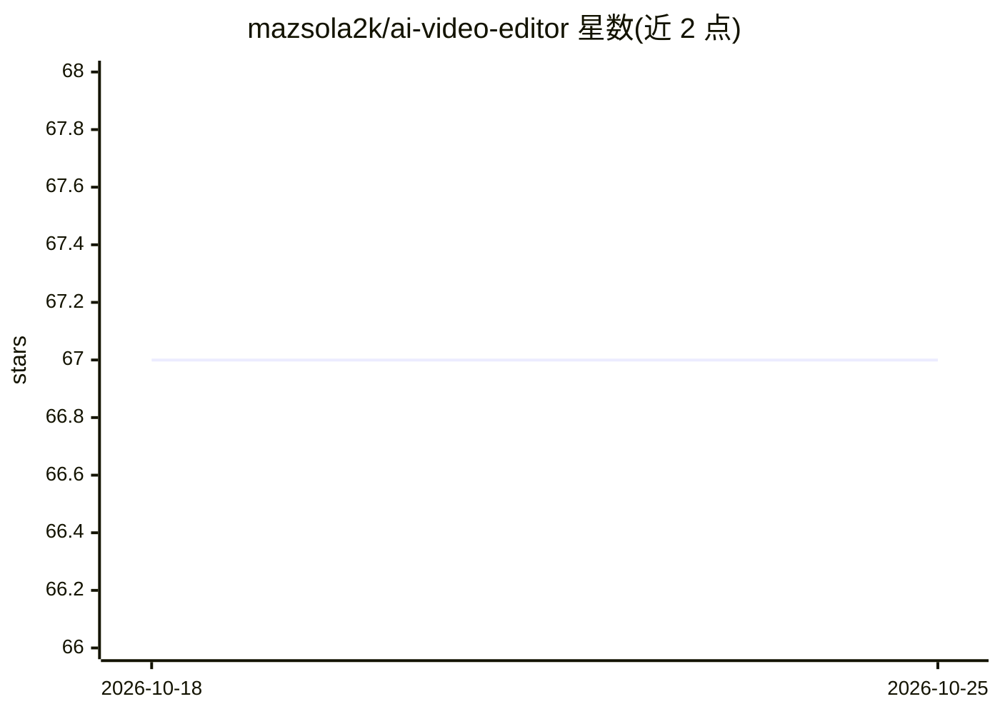

# mazsola2k/ai-video-editor

⭐ 67 · Python · MIT · 推送 2026-04-11 · [GitHub](https://github.com/mazsola2k/ai-video-editor) · 个人维护

**面向个人创作者的长视频 AI 自动剪辑流水线**

用视觉语言模型与计算机视觉自动剪辑长视频的 Python 流水线：每 2 秒抽帧，经 ResNet-50、CLIP 与 Qwen2.5-VL（GGUF，约 4.7GB）对场景分类并赋予 1x-6x 变速，检测静音与冻结片段剔除无聊内容，生成可导入 DaVinci Resolve 的 FCPXML 时间线，并支持 YouTube/Instagram/Facebook 自动发布。提供 build/unboxing/reels 三种模式。需要 FFmpeg（NVENC）、Python 3.9+，GPU 为推荐配置而非必需；验证环境为 Fedora 43 + DaVinci Resolve 20.x。

## 筛选速览

| 维度 | 判定 | 备注 |
|---|---|---|
| AI 角色 | `ai-native` | 本体是模型或模型工具 |
| 许可风险 | `permissive` | MIT |
| 部署形态 | `desktop` | 安装包/桌面程序 |
| 模型依赖 | local-ok | 支持本地模型 |
| 硬件要求 | — | 无带数字的原话,不猜 |
| 安装摩擦 | `medium` | 含编译或系统依赖之一 |
| 成熟度 | — | 结构信号不足 |

## 能力要点

- Qwen2.5-VL + ResNet-50 + CLIP 场景分类与 1x-6x 变速分配
- 三种模式：build（无声变速）/unboxing（保留解说）/reels（9:16 竖版）
- 生成 DaVinci Resolve FCPXML 时间线，含音乐、转场、水印
- YouTube/Instagram/Facebook 多平台自动上传（OAuth 2.0 / Meta Graph API）

## 适用场景

- 把 30-60 分钟的原始素材自动压缩成可发布短视频
- 无人解说的制作过程视频自动变速并配背景音乐
- 解说类视频自动剪切静音与静止片段并生成竖版切片

## 场景标签

`图像视频处理` · 领域:感知与多模态

## 证据(README 行号)

> L7: **The Solution:** This AI-powered pipeline compresses weeks of manual editing into minutes of automated processing. 
> L123: 1. **Stage 1**: Analyzes all videos with AI (ResNet-50, CLIP, Qwen2.5-VL)
> L218:     QWEN["🧠 Qwen2.5-VL-7B (Vision-Language Model) ━━━━━━━━━━━━━━━━━━━━ • Frame captions • Quality 

## 星数曲线

2026-10-18 67 → 2026-10-25 67（+0）

---
*卡片 v1 · prompt 1.4 · 生成 2026-10-24 · 置信度 high · 依据 README sha `be0cb3dad73c` · [字段定义](../../DATASET.md)*
