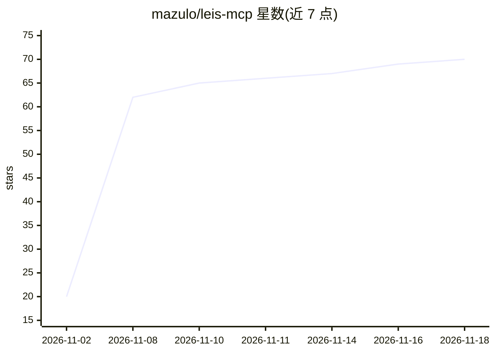

# mazulo/leis-mcp

⭐ 70 · Python · MIT · 推送 2026-11-13 · [GitHub](https://github.com/mazulo/leis-mcp) · 个人维护

**供 AI 助手检索引用巴西法律的 MCP 服务器（120 万条法规）**

面向 Claude Code、Claude Desktop、Cursor、Codex 等任意 MCP 客户端的服务器，接入公开法规库 ctresb/leis，覆盖 120 万条联邦/州/市法规（CF、CLT、CDC、LGPD 等）。提供 buscar_norma、ler_artigo、buscar_texto、listar_normas 四个工具，返回条款原文、官方来源链接、生效状态与废止警示；不判断法律适用，仅转述来源信息。本地 SQLite 索引约 100 MB 每周更新，缓存内容可离线运行。安装途径为 uvx/PyPI、Claude Desktop 扩展包、源码与 Docker。

## 筛选速览

| 维度 | 判定 | 备注 |
|---|---|---|
| AI 角色 | `ai-ecosystem` | LLM/agent 周边工具 |
| 许可风险 | `permissive` | MIT |
| 部署形态 | `self-host` | docker 或自建部署 |
| 模型依赖 | locked-api |  |
| 硬件要求 | — | 无带数字的原话,不猜 |
| 安装摩擦 | `low` | 无编译、无系统依赖或容器化 |
| 成熟度 | — | 结构信号不足 |

## 能力要点

- 返回条款原文并附带官方来源链接与废止/生效警示
- 索引 SQLite 约 100 MB，每周构建，缓存内容离线可用
- 支持 40 余个法规别名（CLT、CDC、LGPD、lei do inquilinato 等）
- 支持 stdio 与 HTTP 两种传输，兼容 Claude Code/Cursor/VS Code/Codex/Gemini CLI 等客户端

## 适用场景

- 在 Claude 等 AI 助手中查询并引用巴西法规条款原文
- 法务或律师借助 AI 助手核对法规的现行文本与修订记录
- 在本地离线环境检索已缓存的法规内容

## 场景标签

 · 领域:法律科技/法律信息检索

## 证据(README 行号)

> L20: **leis-mcp** é um servidor MCP que dá ao Claude Code, ao Claude Desktop, ao Cursor, ao VS Code, ao Codex e a qualqu
> L129: Funciona em qualquer cliente MCP. Todos rodam o mesmo comando, `uvx leis-mcp serve`, depois de um `uvx leis-mcp in

## 星数曲线

2026-11-02 20 → 2026-11-18 70（+50）

---
*卡片 v1 · prompt 1.4 · 生成 2026-11-18 · 置信度 high · 依据 README sha `d0653243c850` · [字段定义](../../DATASET.md)*
