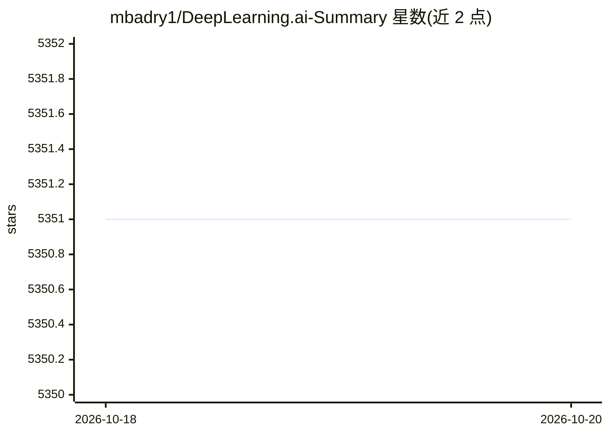

# mbadry1/DeepLearning.ai-Summary

⭐ 5,351 · Python · MIT · 推送 2026-06-27 · [GitHub](https://github.com/mbadry1/DeepLearning.ai-Summary) · 个人维护

**DeepLearning.ai 五门深度学习课程的个人学习笔记汇总**

作者 Mahmoud Badry 完成Coursera 上 DeepLearning.ai 深度学习专项课程后整理的个人笔记仓库，覆盖神经网络基础、超参调优与正则化、机器学习项目结构化、卷积神经网络、序列模型五门课程。README 还收录课程官方介绍、他人笔记链接、多篇课程评论与 Facebook 讨论组入口，并附致谢名单。内容为 Markdown 笔记，无代码安装或运行流程，最后一次署名时间为 2018 年。

## 筛选速览

| 维度 | 判定 | 备注 |
|---|---|---|
| AI 角色 | `ai-knowledge` | 知识聚合/清单类 |
| 许可风险 | `permissive` | MIT |
| 部署形态 | `None` |  |
| 模型依赖 | — | README 未给出锁定关系 |
| 硬件要求 | — | 无带数字的原话,不猜 |
| 安装摩擦 | `low` | 无编译、无系统依赖或容器化 |
| 成熟度 | — | 结构信号不足 |

## 能力要点

- 覆盖五门课程的个人 Markdown 笔记
- 收录他人笔记与多篇第三方课程评论链接
- 附课程讨论社区入口

## 适用场景

- 配合课程复习深度学习专项的各门内容
- 寻找他人整理的课程笔记与评论参考

## 场景标签

`教程课程` · 领域:学习与行业

## 证据(README 行号)

> L3: This repository contains my personal notes and summaries on DeepLearning.ai specialization courses. I've enjoyed eve
> L5: DeepLearning.ai contains five courses which can be taken on Coursera. The five courses titles are:

## 星数曲线

2026-10-18 5,351 → 2026-10-20 5,351（+0）

---
*卡片 v1 · prompt 1.4 · 生成 2026-10-20 · 置信度 high · 依据 README sha `39262289a4ab` · [字段定义](../../DATASET.md)*
