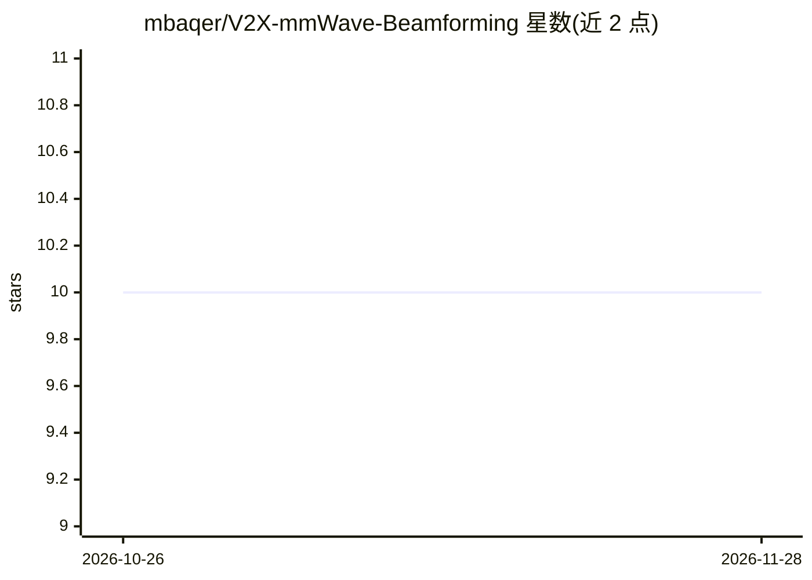

# mbaqer/V2X-mmWave-Beamforming

⭐ 10 · Jupyter Notebook · GPL-3.0 · 推送 2026-01-14 · [GitHub](https://github.com/mbaqer/V2X-mmWave-Beamforming) · 组织维护

**车联网 60GHz 毫米波波束成形的多模态深度学习实现**

面向车联网（V2X）场景的 PyTorch 研究代码库，实现基于深度学习的 60 GHz 毫米波通信波束成形中的多模态感知，融合 RGB、LiDAR 点云、GPS 位置等多种输入模态。代码对应 IEEE TCCN 2026 与 ICC 2024 两篇论文，提供 arXiv 论文链接、引用 BibTeX，并指向 deepsense6G 数据集；README 未包含安装命令或硬件要求，通过邮件联系方式支持交流。

## 筛选速览

| 维度 | 判定 | 备注 |
|---|---|---|
| AI 角色 | `ai-native` | 本体是模型或模型工具 |
| 许可风险 | `viral` | GPL-3.0 |
| 部署形态 | `None` |  |
| 模型依赖 | — | README 未给出锁定关系 |
| 硬件要求 | — | 无带数字的原话,不猜 |
| 安装摩擦 | `low` | 无编译、无系统依赖或容器化 |
| 成熟度 | — | 结构信号不足 |

## 能力要点

- PyTorch 实现的多模态深度学习波束成形模型
- 融合 RGB 图像、LiDAR 点云与 GPS 位置信息
- 对应 IEEE TCCN 2026 与 ICC 2024 两篇论文
- 配套 deepsense6G 公开场景数据集链接

## 适用场景

- 复现论文中车联网毫米波波束成形的实验结果
- 研究多模态深度学习在通信系统中的应用
- 基于 deepsense6G 数据集开展 V2X 感知实验

## 场景标签

`多模态` · 领域:感知与多模态

## 证据(README 行号)

> L2: A project on deep learning based multi-modality sensing in 60 GHz mmWave beamforming for connected vehicles.
> L21: Datasets: https://www.deepsense6g.net/scenarios/

## 星数曲线

2026-10-26 10 → 2026-11-28 10（+0）

---
*卡片 v1 · prompt 1.4 · 生成 2026-11-19 · 置信度 high · 依据 README sha `e36ee619b481` · [字段定义](../../DATASET.md)*
