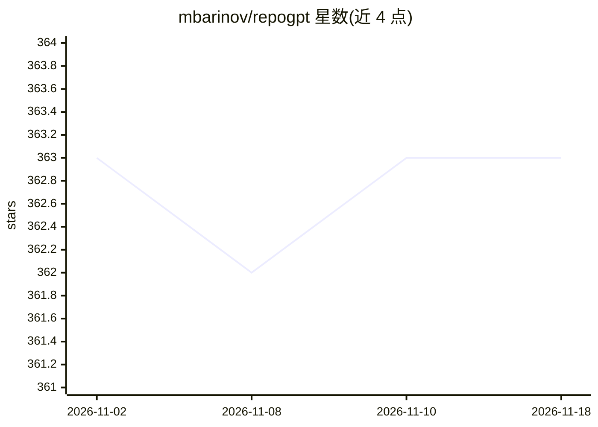

# mbarinov/repogpt

⭐ 363 · TypeScript · MIT · 推送 2026-11-03 · [GitHub](https://github.com/mbarinov/repogpt) · 个人维护

**本地运行的个人 GitHub 仓库问答助手**

面向单人本地使用的 Next.js Web 应用：导入 GitHub 仓库源码，按声明边界/Markdown 章节切分，将 OpenAI 嵌入存入 PostgreSQL（pgvector），检索时结合语义与精确标识符/路径/错误文本的混合查询，流式生成带来源链接的回答。需要 Node.js 24、pnpm、Docker Compose 与 OpenAI API key（付费请求）；无认证与租户隔离，导入限于 2000 文件/10000 块；仅支持 OpenAI 提供商，旧实验性 Ollama PR 不含在本版。

## 筛选速览

| 维度 | 判定 | 备注 |
|---|---|---|
| AI 角色 | `ai-native` | 本体是模型或模型工具 |
| 许可风险 | `permissive` | MIT |
| 部署形态 | `self-host` | docker 或自建部署 |
| 模型依赖 | — | README 未给出锁定关系 |
| 硬件要求 | — | 无带数字的原话,不猜 |
| 安装摩擦 | `low` | 无编译、无系统依赖或容器化 |
| 成熟度 | — | 结构信号不足 |

## 能力要点

- 仓库导入→分块→pgvector 嵌入存储→混合检索→带来源链接的流式回答
- 混合 PostgreSQL 检索，无需额外搜索服务
- 面向单人本地运行设计，数据库默认绑定回环地址
- 索引规模限制：2000 文件、10MB 源码、10000 块，超 256KB 文件跳过

## 适用场景

- 我想直接用自然语言提问自己 GitHub 仓库的代码实现
- 本地检索并理解某个仓库的文档与配置
- 带出处链接地定位代码位置后阅读源码

## 场景标签

`文档问答` · 领域:知识与检索

## 证据(README 行号)

> L6: Chat with a GitHub codebase. RepoGPT imports source files and useful configuration, splits them into chunks, and sto
> L8: Built with Next.js, React, Vercel AI SDK, LangChain, and Prisma. Designed for **one person running it locally**, not

## 星数曲线

2026-11-02 363 → 2026-11-18 363（+0）

---
*卡片 v1 · prompt 1.4 · 生成 2026-11-17 · 置信度 mid · 依据 README sha `dc496b6f6a2c` · [字段定义](../../DATASET.md)*
