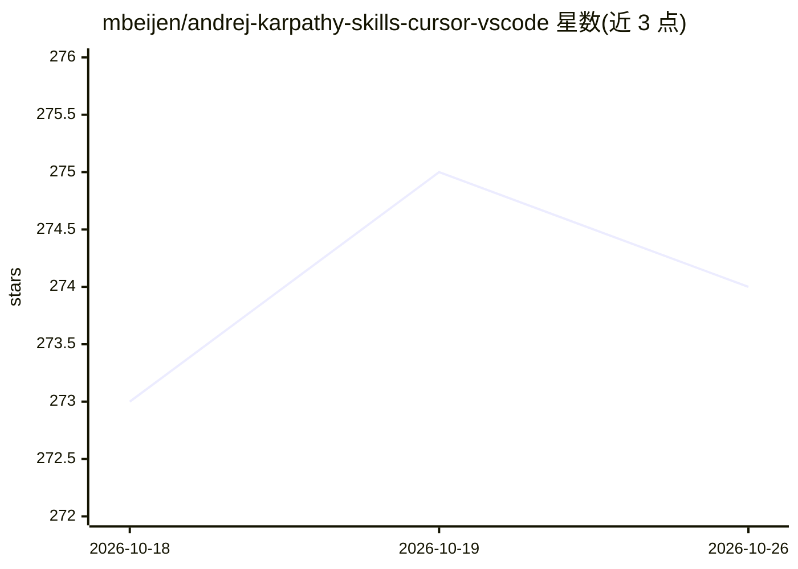

# mbeijen/andrej-karpathy-skills-cursor-vscode

⭐ 274 · TypeScript · 推送 2026-02-11 · [GitHub](https://github.com/mbeijen/andrej-karpathy-skills-cursor-vscode) · [官网](https://tildeweb.nl/~michiel/65-lines-of-markdown-a-claude-code-sensation.html) · 个人维护

**将 Karpathy 编码准则转为 Cursor/VS Code 规则文件的扩展**

一个 VS Code 与 Cursor 编辑器扩展，把源自 Andrej Karpathy 的编码准则（先思考再写代码、简洁优先、外科手术式修改、目标驱动执行四原则）封装为规则文件，通过命令面板一键添加到 .cursor/rules/ 或 .cursorrules。扩展本体无运行时与依赖，核心是约六十行的 markdown 指令内容；也可不用扩展、手动复制 rules/karpathy-guidelines.md 完成。规则内容改编自 forrestchang/andrej-karpathy-skills（MIT）。

## 筛选速览

| 维度 | 判定 | 备注 |
|---|---|---|
| AI 角色 | `ai-knowledge` | 知识聚合/清单类 |
| 许可风险 | `none` | — |
| 部署形态 | `None` |  |
| 模型依赖 | — | README 未给出锁定关系 |
| 硬件要求 | — | 无带数字的原话,不猜 |
| 安装摩擦 | `low` | 无编译、无系统依赖或容器化 |
| 成熟度 | — | 结构信号不足 |

## 能力要点

- 四条编码原则规则文件：命令面板一键注入项目
- 同时发布于 Microsoft Marketplace 与 Open VSX（Cursor 可装）
- 扩展本体无运行时、无依赖，内容为 markdown 指令
- 支持不用扩展的手动复制方式

## 适用场景

- 在 Cursor/VS Code 中让 AI 助手遵循 Karpathy 编码准则
- 为项目快速配置 .cursor/rules 规则文件
- 不装扩展时手动引入规则 markdown

## 场景标签

`提示工程` · 领域:Agent 开发

## 证据(README 行号)

> L3: Turns the Karpathy-inspired coding guidelines into rule files you can use in **Cursor** and **VS Code**.
> L33: I find it a bit wild that extensions for your editor can be little more than a markdown file of sixty-odd lines—no 

## 星数曲线

2026-10-18 273 → 2026-10-26 274（+1）

---
*卡片 v1 · prompt 1.4 · 生成 2026-10-22 · 置信度 high · 依据 README sha `0cab9f93a464` · [字段定义](../../DATASET.md)*
