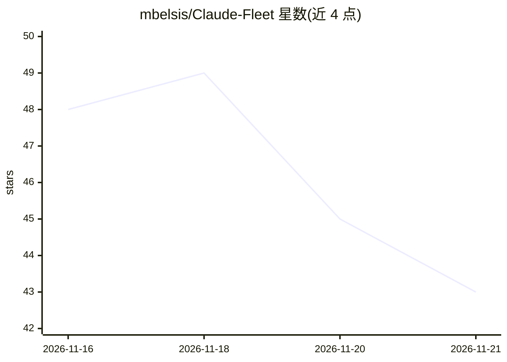

# mbelsis/Claude-Fleet

⭐ 43 · TypeScript · NOASSERTION · 推送 2026-11-16 · [GitHub](https://github.com/mbelsis/Claude-Fleet) · 个人维护

**Claude Code 插件：把任务拆分给多角色子代理并行执行**

面向 Claude Code 用户的插件，将用户提交的任务分派给一组可配置的子代理：市场研究员、首席规划器、1–10 个按指定模型运行的 worker、审阅者、设计器与安全审阅者，除 worker 外各阶段均可选。支持任务依赖与分波执行、按请求的美元预算提示、代理暂停/恢复/重跑、运行文件夹留档与面板实时查看。README 声明这是测试插件（版本 0.8.0），预算为软性提示而非硬上限。

## 筛选速览

| 维度 | 判定 | 备注 |
|---|---|---|
| AI 角色 | `ai-ecosystem` | LLM/agent 周边工具 |
| 许可风险 | `none` | NOASSERTION |
| 部署形态 | `None` |  |
| 模型依赖 | locked-api |  |
| 硬件要求 | — | 无带数字的原话,不猜 |
| 安装摩擦 | `low` | 无编译、无系统依赖或容器化 |
| 成熟度 | `idea` | |

## 能力要点

- 任务经规划器拆分为多 worker 简报，依赖任务分波执行
- 每个角色（研究员/规划器/审阅/设计/安全审查）可指定不同模型
- 面板实时展示各代理进度、token 与成本，支持暂停/恢复/重跑
- 按请求设置美元预算（warn/stop）并生成运行文件夹留档

## 适用场景

- 把写作、调研或代码任务并行分派给多个子代理完成
- 为 Claude Code 的任务增加安全审查与设计成稿阶段
- 控制多代理任务的时长与花费上限

## 场景标签

`编码 Agent` `多智能体` · 领域:Agent 开发

## 证据(README 行号)

> L1: # Agent fleet for Claude Code
> L3: A Claude Code plugin that splits each task you give Claude across a fleet of subagents you configure — a market rese
> L44: - **Worker slots:** how many subagents a task uses (1–10) and which model each runs on: `/fleet 4 sonnet sonnet opu

## 星数曲线

2026-11-16 48 → 2026-11-21 43（-5）

---
*卡片 v1 · prompt 1.4 · 生成 2026-11-18 · 置信度 high · 依据 README sha `24fa975825e8` · [字段定义](../../DATASET.md)*
