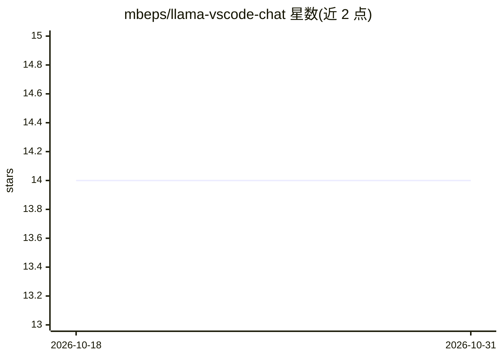

# mbeps/llama-vscode-chat

⭐ 14 · TypeScript · MIT · 推送 2026-05-23 · [GitHub](https://github.com/mbeps/llama-vscode-chat) · [官网](https://marketplace.visualstudio.com/items?itemName=maruf-bepary.llama-vscode-chat) · 个人维护

**把 Llama.cpp 本地模型接入 VS Code GitHub Copilot 聊天的扩展**

TypeScript 编写的 VS Code 扩展，作为 Llama.cpp provider 接入 VS Code 的语言模型聊天接口，使用户在 GitHub Copilot 中使用本地 Llama.cpp 服务器的模型。基于 OpenAI 兼容 chat API 的基类实现，支持流式响应、工具调用（function calling）与多模型管理。要求 VS Code 1.104.0 以上和已运行的 Llama.cpp 服务器，通过命令面板配置服务器 URL。作者声明因本地算力不足未充分测试。

## 筛选速览

| 维度 | 判定 | 备注 |
|---|---|---|
| AI 角色 | `ai-ecosystem` | LLM/agent 周边工具 |
| 许可风险 | `permissive` | MIT |
| 部署形态 | `library` | 以包/库形式分发 |
| 模型依赖 | — | README 未给出锁定关系 |
| 硬件要求 | — | 无带数字的原话,不猜 |
| 安装摩擦 | `low` | 无编译、无系统依赖或容器化 |
| 成熟度 | `idea` | |

## 能力要点

- 将 Llama.cpp 服务器集成进 VS Code 语言模型聊天
- 支持流式响应与工具调用（OpenAI 兼容格式）
- 管理 Llama.cpp 服务器上的多个模型

## 适用场景

- 在 VS Code Copilot 聊天里调用本地 Llama.cpp 模型
- 本地开发时避免依赖云端模型服务
- 通过配置服务器 URL 切换多个本地模型

## 场景标签

`AI 助手` · 领域:对话与助手

## 证据(README 行号)

> L3: This extension integrates Llama.cpp models into GitHub Copilot in VS Code.
> L9: - Integrates Llama.cpp server into VS Code's language model chat.

## 星数曲线

2026-10-18 14 → 2026-10-31 14（+0）

---
*卡片 v1 · prompt 1.4 · 生成 2026-10-31 · 置信度 mid · 依据 README sha `2c37bd0dc891` · [字段定义](../../DATASET.md)*
