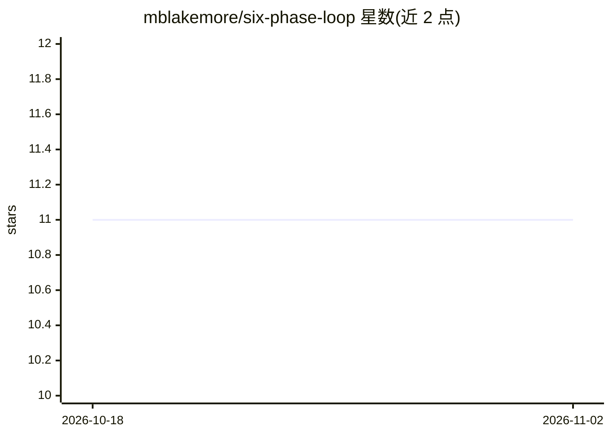

# mblakemore/six-phase-loop

⭐ 11 · 推送 2026-02-28 · [GitHub](https://github.com/mblakemore/six-phase-loop) · 个人维护

**六阶段认知循环架构：用 CLAUDE.md 与 git 构建持久化 AI agent**

一个视频演示的配套参考实现仓库，提出六阶段认知循环（感知→反思→决策→行动→巩固→持久化）作为构建可跨会话学习、维持身份并持续积累知识的 AI agent 的架构。核心交付物是 example-CLAUDE.md 系统提示词文件，将其放入 git 仓库并以 Claude Code 运行即可启动循环；持久化依靠 state 目录与 git commit，无需框架或编排平台。README 记录了五步构建流程、运行经验教训与多 agent 协同扩展方式。

## 筛选速览

| 维度 | 判定 | 备注 |
|---|---|---|
| AI 角色 | `ai-ecosystem` | LLM/agent 周边工具 |
| 许可风险 | `none` | — |
| 部署形态 | `None` |  |
| 模型依赖 | — | README 未给出锁定关系 |
| 硬件要求 | — | 无带数字的原话,不猜 |
| 安装摩擦 | `low` | 无编译、无系统依赖或容器化 |
| 成熟度 | — | 结构信号不足 |

## 能力要点

- 六阶段循环：PERCEIVE→REFLECT→DECIDE→ACT→CONSOLIDATE→PERSIST
- 以单个 CLAUDE.md 系统提示词作为完整参考实现
- 持久化基于 state 目录与 git commit，不依赖框架或编排平台
- README 记录 3,000+ 连续循环、25,000+ 知识模式积累的运行数据

## 适用场景

- 为 Claude Code 构建跨会话记忆与自我维护的 agent
- 参考认知循环架构设计自己的持久化 agent
- 搭建多个专用 agent 共享知识库协同工作

## 场景标签

`提示工程` `Agent 记忆` `多智能体` · 领域:Agent 开发

## 证据(README 行号)

> L9: This repository contains the reference implementation for the **Six-Phase Cognitive Loop** — an architecture for bui
> L19: Drop `example-CLAUDE.md` into any git repository as `CLAUDE.md`. Run Claude Code. The agent begins.
> L62: No framework required. No orchestration platform. Just files and git.

## 星数曲线

2026-10-18 11 → 2026-11-02 11（+0）

---
*卡片 v1 · prompt 1.4 · 生成 2026-11-02 · 置信度 high · 依据 README sha `139c91851230` · [字段定义](../../DATASET.md)*
