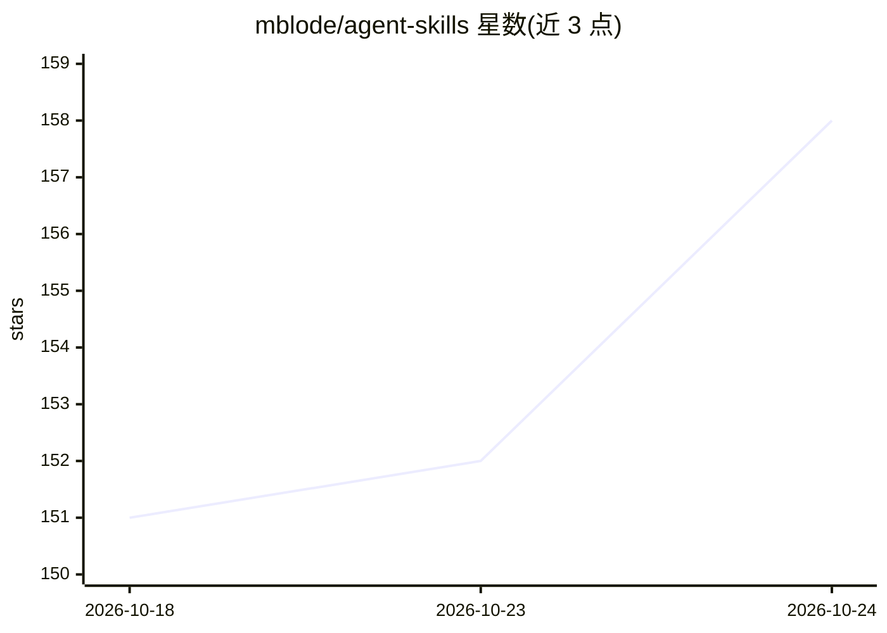

# mblode/agent-skills

⭐ 158 · Shell · MIT · 推送 2026-10-23 · [GitHub](https://github.com/mblode/agent-skills) · [官网](https://blode.co/agent-skills) · 个人维护

**面向编码代理的按需技能集：UI 审计、排版、文档、PR 审查与发布**

一套供编码代理（Codex、Claude Code）按需加载的技能集合，含 20 余个技能，分 Architecture、Design、Writing、Quality、Shipping、Authoring 六类：如代码库架构设计、Next.js/CLI 脚手架、UI 设计与九项浏览器探针验证、24 规则 agentic 体验审计、78 规则排版审计、PR 审查（tidy）与 npm 自动发布等。通过 npx skills add 命令安装，MIT 许可。另附面向人类的 Taste Training 课程链接。

## 筛选速览

| 维度 | 判定 | 备注 |
|---|---|---|
| AI 角色 | `ai-ecosystem` | LLM/agent 周边工具 |
| 许可风险 | `permissive` | MIT |
| 部署形态 | `library` | 以包/库形式分发 |
| 模型依赖 | — | README 未给出锁定关系 |
| 硬件要求 | — | 无带数字的原话,不猜 |
| 安装摩擦 | `low` | 无编译、无系统依赖或容器化 |
| 成熟度 | — | 结构信号不足 |

## 能力要点

- 六类 20 余个技能：架构脚手架、UI 审计/验证、排版审计、PR 审查、发布自动化
- tidy 技能输出 file:line 级 confirmed/plausible 两档审查结果，默认只读可应用
- ui-verification 运行九项浏览器探针并以截图比对验证修复
- 一条 npx 命令安装全部技能

## 适用场景

- 让编码代理执行 UI/排版/DX 的规则化审计
- 自动化 PR 审查、npm 发布与 CI 提速流程
- 统一 Claude Code/Codex/Cursor 读取的仓库指令（agents-md）

## 场景标签

`代码审查` `代码生成` · 领域:编码与开发

## 证据(README 行号)

> L5: UI audits, typography, docs, PR review, and releases. On-demand skills for coding agents.
> L17: npx skills add mblode/agent-skills -g --agent codex claude-code -y

## 星数曲线

2026-10-18 151 → 2026-10-24 158（+7）

---
*卡片 v1 · prompt 1.4 · 生成 2026-10-23 · 置信度 high · 依据 README sha `30e1c6274bc2` · [字段定义](../../DATASET.md)*
