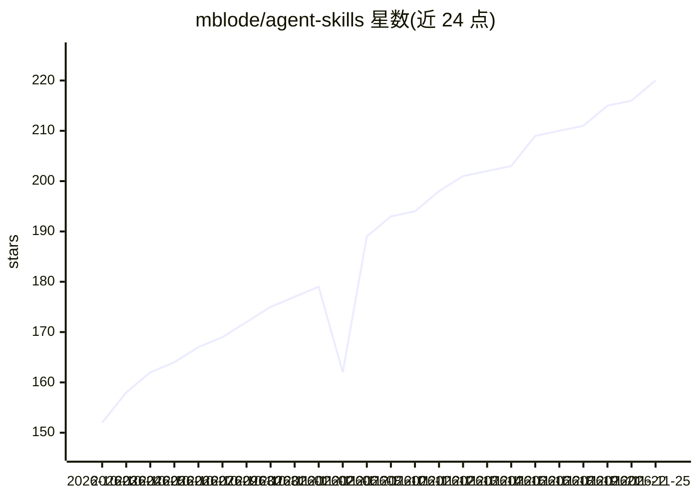

# mblode/agent-skills

⭐ 220 · TypeScript · MIT · 推送 2026-11-23 · [GitHub](https://github.com/mblode/agent-skills) · [官网](https://blode.co/agent-skills) · 个人维护

**给编码 agent 用的按需技能集：UI/文档/PR审查/发布**

为编码 agent 提供按需加载的技能集合，覆盖架构设计（agent-ready-repo、Next.js/CLI 脚手架）、设计（UI 审计、UI 验证、动画）、写作（eli5、ghostwriter）、质量（可访问性/开发者体验/排版审计、测试修剪）、发布（计划、PR 审查、PR 创建、CI 提速）与技能创作等类别。通过 npx skills add 安装到 Codex、Claude Code 等 agent，技能以指令/规则形式指导 agent 执行检查与产出报告；另提供面向人类的 Taste Training 课程。MIT 许可。

## 筛选速览

| 维度 | 判定 | 备注 |
|---|---|---|
| AI 角色 | `ai-knowledge` | 知识聚合/清单类 |
| 许可风险 | `permissive` | MIT |
| 部署形态 | `library` | 以包/库形式分发 |
| 模型依赖 | — | README 未给出锁定关系 |
| 硬件要求 | — | 无带数字的原话,不猜 |
| 安装摩擦 | `low` | 无编译、无系统依赖或容器化 |
| 成熟度 | — | 结构信号不足 |

## 能力要点

- 按类别组织的技能集合：架构/设计/写作/质量/发布/创作
- npx skills add 一条命令安装到 Codex 与 Claude Code
- 审计类技能带量化规则（如 typography-audit 78 条、dx-audit 38 条）
- tidy 支持 report-only 默认模式与 apply 落地修复两种方式

## 适用场景

- 给 Claude Code / Codex 加装 UI、排版、文档等专项审查能力
- 让 agent 按 file:line 分级输出 PR 审查发现并按需落地修复
- 用 changesets 与 OIDC 验证自动发布 npm 包
- 为仓库编写与审计 AGENTS.md 指令文件

## 场景标签

`编码 Agent` `教程课程` · 领域:编码与开发

## 证据(README 行号)

> L1: # Agent Skills
> L5: UI audits, typography, docs, PR review, and releases. On-demand skills for coding agents.
> L24: ## Skills

## 星数曲线

2026-10-23 152 → 2026-11-25 220（+68）

---
*卡片 v1 · prompt 1.4 · 生成 2026-11-25 · 置信度 high · 依据 README sha `8f3cdf72a0a3` · [字段定义](../../DATASET.md)*
