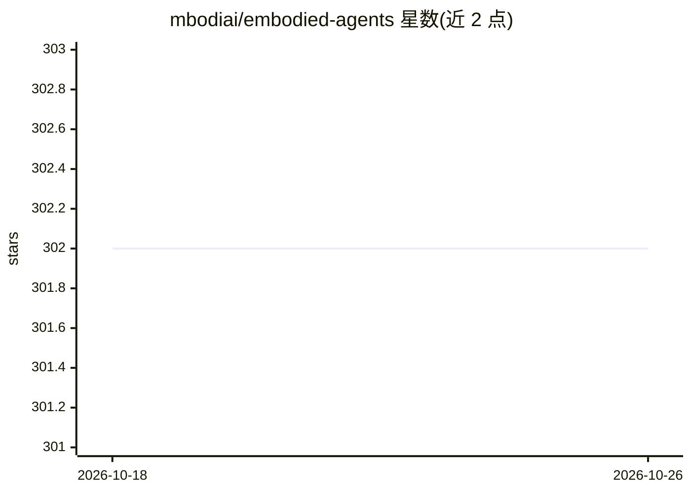

# mbodiai/embodied-agents

⭐ 302 · Python · Apache-2.0 · 推送 2025-12-16 · [GitHub](https://github.com/mbodiai/embodied-agents) · [官网](https://mbodi.ai) · 组织维护

**把多模态大模型接入机器人栈的 Python 工具包**

mbodiai 公司维护的具身智能工具包，将语言、运动、感知三类模型以 Agent 抽象接入现有机器人栈：Language Agent 支持 OpenAI、Anthropic、Gemini、vLLM、Ollama 等后端，Motor Agent 支持 OpenVLA 等机器人 transformer，Sensory Agent 支持深度估计、目标检测、图像分割。提供 Sample/Message 类型系统，可在 Gym Space、Tensor、HuggingFace Dataset、Pydantic 间转换，支持远程/异步执行与数据集录制上传。自述面向研究与原型开发，处于实验阶段，可能出现破坏性变更；未实现从上下文经验中学习。

## 筛选速览

| 维度 | 判定 | 备注 |
|---|---|---|
| AI 角色 | `ai-ecosystem` | LLM/agent 周边工具 |
| 许可风险 | `permissive` | Apache-2.0 |
| 部署形态 | `library` | 以包/库形式分发 |
| 模型依赖 | local-ok | 支持本地模型 |
| 硬件要求 | — | 无带数字的原话,不猜 |
| 安装摩擦 | `low` | 无编译、无系统依赖或容器化 |
| 成熟度 | `idea` | |

## 能力要点

- Language/Motor/Sensory 三类 Agent 抽象，统一 act 接口
- 兼容 HuggingFace Spaces、Gymnasium、Ollama 及任何 OpenAI 兼容 API
- Sample 类型在 Gym Space/Tensor/HF Dataset/Pydantic 间转换
- 自动数据集录制并可上传 HuggingFace Hub

## 适用场景

- 在真机或仿真环境中用自然语言驱动机器人执行任务
- 用 OpenVLA 等机器人 transformer 模型控制机械臂动作
- 在机器人上按频率采集动作数据集并上传共享

## 场景标签

`多模态` `目标检测` `Agent 框架` · 领域:Agent 开发

## 证据(README 行号)

> L52: **embodied agents** is a toolkit for integrating large multi-modal models into existing robot stacks with just a fe
> L86: hobbyists, and developers. This library aims to address these challenges by providing a simple, extensible, and eff

## 星数曲线

2026-10-18 302 → 2026-10-26 302（+0）

---
*卡片 v1 · prompt 1.4 · 生成 2026-10-22 · 置信度 high · 依据 README sha `2d9c11f7bdac` · [字段定义](../../DATASET.md)*
