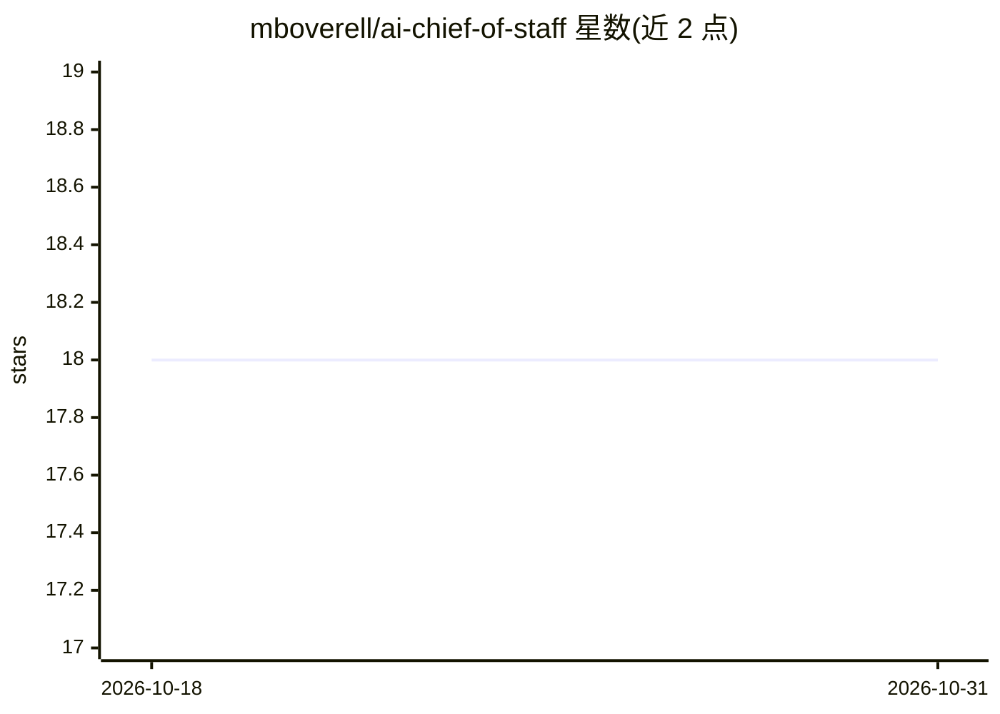

# mboverell/ai-chief-of-staff

⭐ 18 · MIT · 推送 2026-01-25 · [GitHub](https://github.com/mboverell/ai-chief-of-staff) · 个人维护

**个人 AI 参谋系统：把笔记/日历/邮件综合成高管级洞察**

构建在 Obsidian 纯文本知识库之上的个人 AI 系统：所有记忆以自有纯文本文件存储，对外部数据（日历、邮件）采取只读访问。技能定义为多步骤工作流而非提示词，通过 Claude Code 在本地执行，包含每周回顾（综合会议、日历、邮件、git 提交）、每日 6 点 Telegram 简报、手机只读查询与按计划定时运行的技能。作者自述已日常使用六周，采用 QUICKSTART.md 30 分钟上手路径。

## 筛选速览

| 维度 | 判定 | 备注 |
|---|---|---|
| AI 角色 | `ai-native` | 本体是模型或模型工具 |
| 许可风险 | `permissive` | MIT |
| 部署形态 | `None` |  |
| 模型依赖 | — | README 未给出锁定关系 |
| 硬件要求 | — | 无带数字的原话,不猜 |
| 安装摩擦 | `low` | 无编译、无系统依赖或容器化 |
| 成熟度 | — | 结构信号不足 |

## 能力要点

- 每周回顾技能综合会议、日历、邮件与 git 提交，捕捉未闭环事项
- 每日 6 AM 经 Telegram 送达简报，支持手机只读查询
- 记忆存于自有纯文本文件，可随时切换模型
- 技能为多步骤工作流，支持配置驱动的定时执行

## 适用场景

- 把我的会议笔记与日历综合成每周执行摘要
- 每天早晨在 Telegram 收到优先事项简报
- 用自有文本文件而非厂商系统管理 AI 记忆层

## 场景标签

`AI 助手` `知识库管理` `工作流自动化` · 领域:效率与自动化

## 证据(README 行号)

> L3: A personal AI that synthesizes your notes, calendar, and email into executive-level insight. Built on plain text fil
> L16: - **Daily briefing** — Arrives at 6 AM via Telegram. Calendar, priority emails, weekly focus.

## 星数曲线

2026-10-18 18 → 2026-10-31 18（+0）

---
*卡片 v1 · prompt 1.4 · 生成 2026-10-29 · 置信度 mid · 依据 README sha `e5fa9e9b22c4` · [字段定义](../../DATASET.md)*
