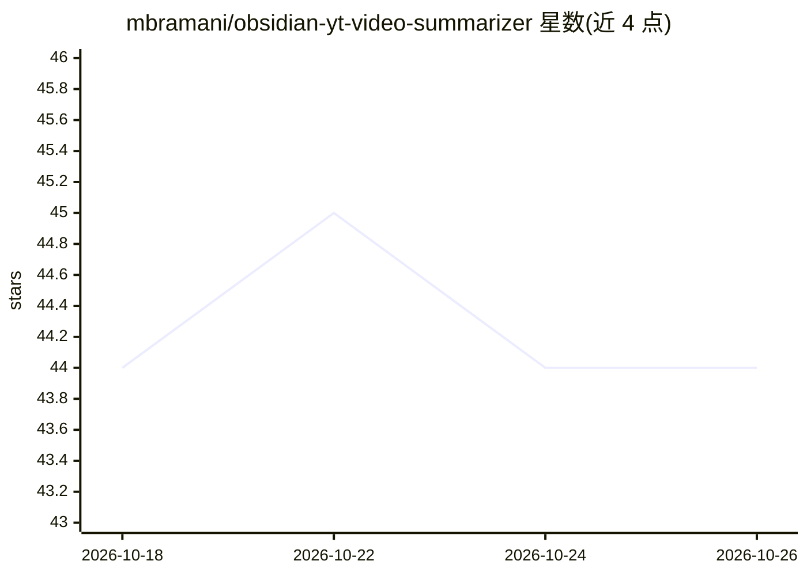

# mbramani/obsidian-yt-video-summarizer

⭐ 44 · TypeScript · MIT · 推送 2026-04-28 · [GitHub](https://github.com/mbramani/obsidian-yt-video-summarizer) · 个人维护

**Obsidian 插件：用 LLM 为 YouTube 视频生成摘要笔记**

Obsidian 社区插件，提取 YouTube 视频字幕并发送给 Gemini、OpenAI、Anthropic 等 LLM 生成结构化摘要笔记，包含 Summary、Key Points、Technical Terms 等默认章节。支持自定义提示词、温度与最大 token 数设置，可添加 OpenAI/Anthropic API 兼容的自定义提供方（OpenRouter、Grok、自托管模型均经过测试）。通过命令面板或选中 URL 触发，输出笔记附带视频标题、缩略图与频道链接等元数据。需 Obsidian v0.15.0+ 与至少一个 LLM API key。

## 筛选速览

| 维度 | 判定 | 备注 |
|---|---|---|
| AI 角色 | `ai-native` | 本体是模型或模型工具 |
| 许可风险 | `permissive` | MIT |
| 部署形态 | `None` |  |
| 模型依赖 | locked-api |  |
| 硬件要求 | — | 无带数字的原话,不猜 |
| 安装摩擦 | `low` | 无编译、无系统依赖或容器化 |
| 成熟度 | — | 结构信号不足 |

## 能力要点

- 提取 YouTube 字幕并生成含 Summary/Key Points/Technical Terms 的结构化笔记
- 支持 Gemini/OpenAI/Anthropic 及 OpenAI/Anthropic 兼容的自定义提供方
- 可自定义摘要提示词、温度与最大 token 数
- 输出笔记附带视频标题、缩略图、频道与视频链接元数据

## 适用场景

- 在 Obsidian 中把 YouTube 视频整理为可检索的摘要笔记
- 学习技术视频时快速获取要点与术语解释
- 用自选 LLM 提供方定制视频摘要格式

## 场景标签

`AI 写作` · 领域:内容生成

## 证据(README 行号)

> L3: Generate AI-powered summaries of YouTube videos directly in Obsidian using Gemini, OpenAI, Anthropic, and other comp
> L12: - 🤖 Generate summaries using various LLMs: Gemini, OpenAI, Anthropic (Claude), and other compatible models

## 星数曲线

2026-10-18 44 → 2026-10-26 44（+0）

---
*卡片 v1 · prompt 1.4 · 生成 2026-10-25 · 置信度 high · 依据 README sha `d3e750939699` · [字段定义](../../DATASET.md)*
