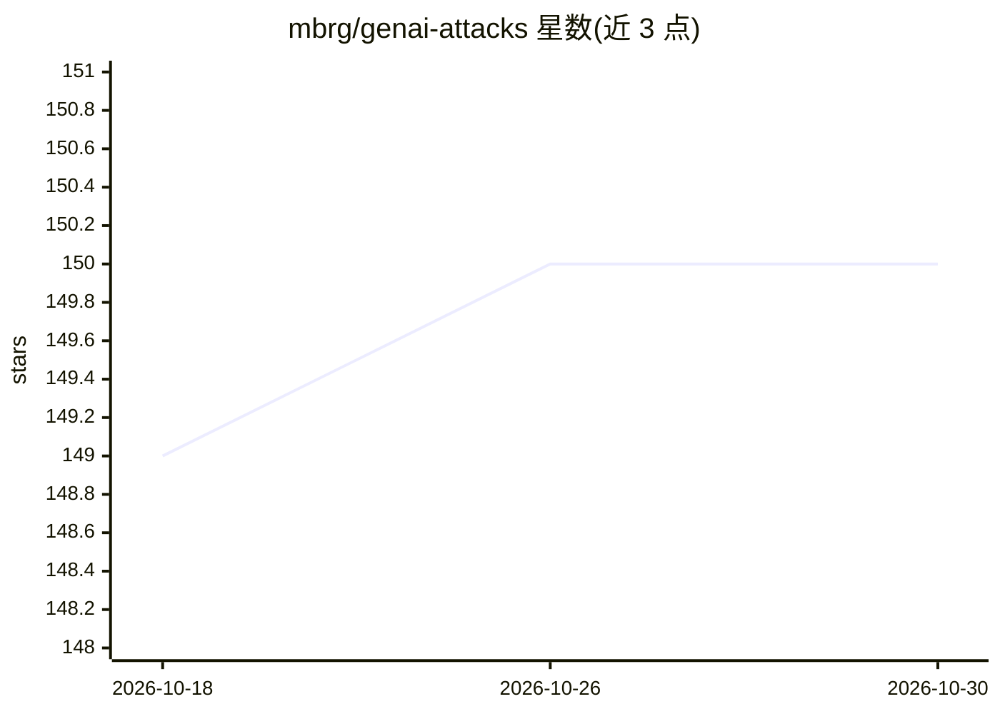

# mbrg/genai-attacks

⭐ 150 · Python · 推送 2025-12-22 · [GitHub](https://github.com/mbrg/genai-attacks) · [官网](https://ttps.ai) · 个人维护

**面向 GenAI 智能体与 Copilot 的攻击技术（TTP）知识库**

记录攻击 AI agents、copilots 与自主系统所用战术、技术与过程（TTP）的知识库项目，目标读者是关注 AI 系统安全的研究者与防御方。内容指出 Promptware（含恶意指令的内容）构成新攻击面，主张采用借鉴 EDR 的纵深防御思路管理而非枚举恶意提示。贡献方式为编辑或新增 JSON 文件（tactic/technique 等目录），PR 合并后网站自动更新；项目受 MITRE ATT&CK 启发。

## 筛选速览

| 维度 | 判定 | 备注 |
|---|---|---|
| AI 角色 | `ai-knowledge` | 知识聚合/清单类 |
| 许可风险 | `none` | — |
| 部署形态 | `None` |  |
| 模型依赖 | — | README 未给出锁定关系 |
| 硬件要求 | — | 无带数字的原话,不猜 |
| 安装摩擦 | `low` | 无编译、无系统依赖或容器化 |
| 成熟度 | — | 结构信号不足 |

## 能力要点

- 以 tactic/technique JSON 文件组织攻击技术知识
- PR 自动做 schema 合规测试，合并后网站数分钟内更新
- 浏览器内直接编辑或新建 JSON 即可贡献

## 适用场景

- 了解针对 GenAI 智能体的攻击手法全生命周期
- 为 AI 系统设计纵深防御策略时查阅 TTP
- 以 MITRE ATT&CK 式方式贡献与共享攻击知识

## 场景标签

`网络安全` · 领域:学习与行业

## 证据(README 行号)

> L3: |🔦|AI Agents Attack Matrix is a knowledge source about TTPs used to target AI agents, copilots, and autonomous syste
> L12: Our first collective attempt at fighting malware was Antivirus software which tried to enumerate every known malwar

## 星数曲线

2026-10-18 149 → 2026-10-30 150（+1）

---
*卡片 v1 · prompt 1.4 · 生成 2026-10-23 · 置信度 high · 依据 README sha `638f70faf2a6` · [字段定义](../../DATASET.md)*
