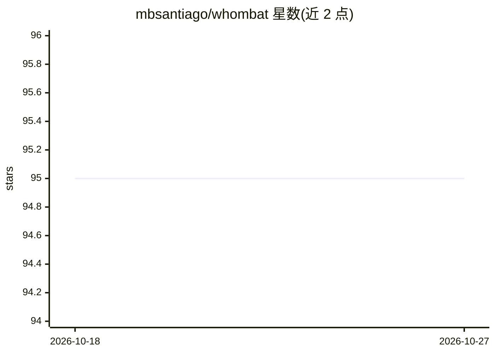

# mbsantiago/whombat

⭐ 95 · TypeScript · GPL-3.0 · 推送 2026-07-08 · [GitHub](https://github.com/mbsantiago/whombat) · [官网](https://mbsantiago.github.io/whombat/) · 组织维护

**面向 ML 开发的开源网页音频标注工具（生物声学）**

Whombat 是开源、网页形式的音频标注与数据标注工具，服务于机器学习模型开发的数据准备环节，重点关注生物声学场景。提供两类安装途径：从 GitHub Releases 下载对应操作系统的捆绑版本，或通过 pip 安装 Python 包后以 python -m whombat 运行。仓库分前后端两个应用（Python 后端用 uv 管理，Next.js 前端用 npm 管理），开发任务通过 just 命令执行。附有论文（arXiv:2308.12688），由 CONAHCyT 与 UCL 支持开发。

## 筛选速览

| 维度 | 判定 | 备注 |
|---|---|---|
| AI 角色 | `ai-ecosystem` | LLM/agent 周边工具 |
| 许可风险 | `viral` | GPL-3.0 |
| 部署形态 | `library` | 以包/库形式分发 |
| 模型依赖 | — | README 未给出锁定关系 |
| 硬件要求 | — | 无带数字的原话,不猜 |
| 安装摩擦 | `low` | 无编译、无系统依赖或容器化 |
| 成熟度 | — | 结构信号不足 |

## 能力要点

- 网页形式的开源音频标注工具，聚焦生物声学与 ML 开发
- 支持 Releases 捆绑包或 pip 安装两种方式
- 前后端分离架构（Python 后端 + Next.js 前端）

## 适用场景

- 为机器学习模型准备带标注的音频数据集
- 生物声学研究中进行音频片段标注
- 团队通过浏览器协作进行音频标注

## 场景标签

`MLOps` · 领域:训练与推理

## 证据(README 行号)

> L13: **Whombat** is an open-source, web-based audio annotation tool designed to streamline audio data labeling and annot
> L83: > Balvanera, S. M., Mac Aodha, O., Weldy, M. J., Pringle, H., Browning, E., & Jones, K. E. (2023). Whombat: An open

## 星数曲线

2026-10-18 95 → 2026-10-27 95（+0）

---
*卡片 v1 · prompt 1.4 · 生成 2026-10-23 · 置信度 mid · 依据 README sha `5585662c9168` · [字段定义](../../DATASET.md)*
