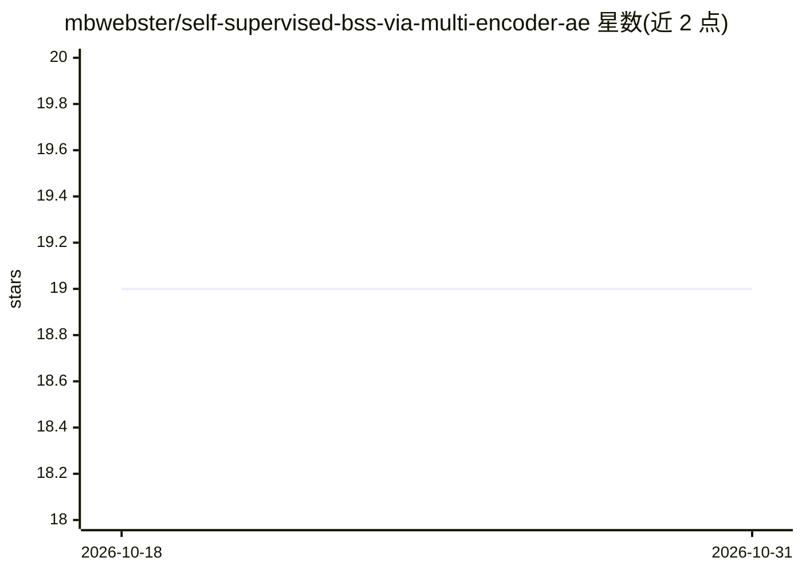

# mbwebster/self-supervised-bss-via-multi-encoder-ae

⭐ 19 · Jupyter Notebook · MIT · 推送 2025-12-13 · [GitHub](https://github.com/mbwebster/self-supervised-bss-via-multi-encoder-ae) · 个人维护

**科研代码：多编码器自编码器做单通道盲源分离**

Neurocomputing 论文官方仓库，提出基于多编码器单解码器自编码器的全自监督盲源分离方法：训练时将输入解混到各编码空间再经解码器重构，推理时通过编码掩码（仅保留一个编码、其余置零）估计单个源信号。引入稀疏混合损失与零重构损失两项正则化。在 triangles & circles 合成数据集与 MESA 睡眠研究的 ECG/PPG 真实生物信号上实验，用于提取呼吸源。通过 python trainer.py 加配置运行；MESA 数据需自行申请并预处理，仓库不提供该处理代码。

## 筛选速览

| 维度 | 判定 | 备注 |
|---|---|---|
| AI 角色 | `ai-native` | 本体是模型或模型工具 |
| 许可风险 | `permissive` | MIT |
| 部署形态 | `None` |  |
| 模型依赖 | — | README 未给出锁定关系 |
| 硬件要求 | — | 无带数字的原话,不猜 |
| 安装摩擦 | `low` | 无编译、无系统依赖或容器化 |
| 成熟度 | — | 结构信号不足 |

## 能力要点

- 多编码器自编码器 + 编码掩码实现自监督盲源分离
- 稀疏混合损失与零重构损失两项正则化
- 在合成数据集与 MESA 多导睡眠图 ECG/PPG 数据上实验，提取呼吸源
- 提供 python trainer.py experiment_config=... 训练命令与 Jupyter 测试/数据生成 notebook

## 适用场景

- 复现论文中的盲源分离实验
- 从 ECG/PPG 单通道信号中提取呼吸信号
- 研究生物信号自监督分离方法的研究者参考方法实现

## 场景标签

`科研工具` · 领域:学习与行业

## 证据(README 行号)

> L8: ## Summary
> L61: ### ECG & PPG Respiratory Source Extraction

## 星数曲线

2026-10-18 19 → 2026-10-31 19（+0）

---
*卡片 v1 · prompt 1.4 · 生成 2026-10-28 · 置信度 high · 依据 README sha `44b5932805f8` · [字段定义](../../DATASET.md)*
