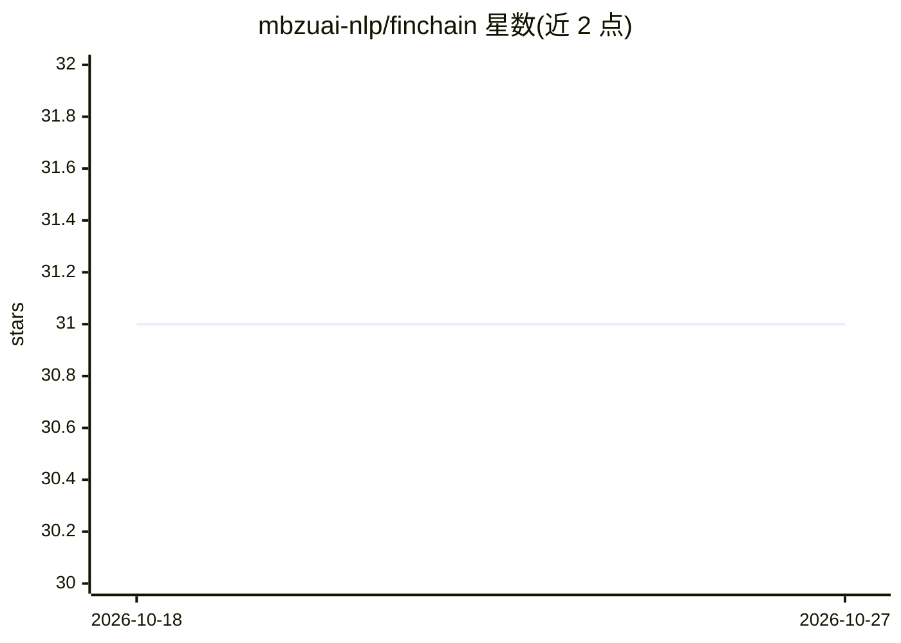

# mbzuai-nlp/finchain

⭐ 31 · Python · Apache-2.0 · 推送 2026-09-17 · [GitHub](https://github.com/mbzuai-nlp/finchain) · [官网](https://mbzuai-nlp.github.io/finchain/) · 组织维护

**金融领域可验证思维链推理的符号基准数据集与评测指标**

面向大模型金融推理评测的符号基准：基于 58 个金融主题×5 个符号模板生成 2,900 条机器可验证实例，覆盖公司金融、投资分析、风险管理等 12 个领域；每条实例附带黄金推理链与可执行 Python 代码用于真值生成与验证。提供 ChainEval 评测框架，同时度量最终答案正确性（FAC）与推理步骤对齐（语义相似度+逐步数值一致性），并已评测 26 个模型。以 git clone 源码方式使用，数据为符号方程合成的合成数据。

## 筛选速览

| 维度 | 判定 | 备注 |
|---|---|---|
| AI 角色 | `ai-ecosystem` | LLM/agent 周边工具 |
| 许可风险 | `permissive` | Apache-2.0 |
| 部署形态 | `None` |  |
| 模型依赖 | — | README 未给出锁定关系 |
| 硬件要求 | — | 无带数字的原话,不猜 |
| 安装摩擦 | `low` | 无编译、无系统依赖或容器化 |
| 成熟度 | — | 结构信号不足 |

## 能力要点

- 2,900 条机器可验证实例（58 主题 × 5 模板 × 10 种子）
- 可执行 Python 轨迹支持步骤级答案验证
- ChainEval 联合评测最终答案与中间步骤（语义相似度 + 数值一致性）
- 已对 26 个模型（前沿/金融微调/数学增强/开源）完成评测

## 适用场景

- 评测大模型在多步金融推理中的表现与错误环节
- 定位模型在哪一步出现幻觉、跳步或算错
- 比较金融微调模型与通用模型在金融推理上的差异

## 场景标签

`模型评测` `金融量化` · 领域:评测与运维

## 证据(README 行号)

> L11: **FinChain** is the first benchmark designed for **verifiable chain-of-thought (CoT) financial reasoning**. It eval
> L65: FinChain introduces **ChainEval**, a joint evaluation framework for:

## 星数曲线

2026-10-18 31 → 2026-10-27 31（+0）

---
*卡片 v1 · prompt 1.4 · 生成 2026-10-26 · 置信度 high · 依据 README sha `e125995b892b` · [字段定义](../../DATASET.md)*
