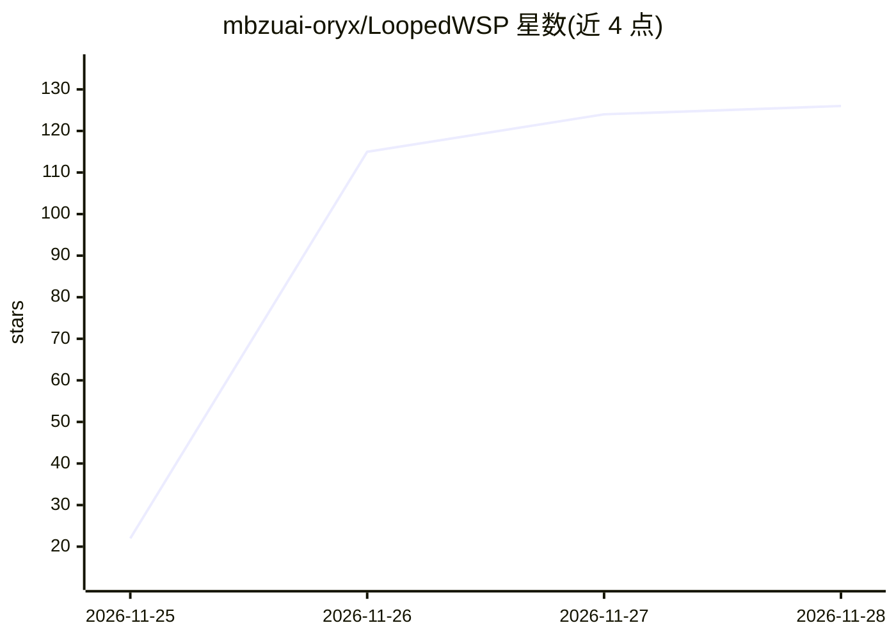

# mbzuai-oryx/LoopedWSP

⭐ 126 · Python · MIT · 推送 2026-11-24 · [GitHub](https://github.com/mbzuai-oryx/LoopedWSP) · [官网](https://mbzuai-oryx.github.io/LoopedWSP/) · 组织维护

**LLM 手写权重的循环 Transformer 权重与提示词仓库**

MBZUAI 团队发布的仓库，收录由 Claude 在无训练条件下手写权重的十个小型循环 Transformer（looped weight-space programming），单块权重反复迭代逐步推进求解。weights/ 目录提供权重与 run.py 运行脚本，prompts/ 目录保存实验原始提示词，覆盖 Maze-Hard、Sudoku-Extreme、Tower of Hanoi 等任务。运行仅需 Python 3 与 numpy，采用 MIT 许可。

## 筛选速览

| 维度 | 判定 | 备注 |
|---|---|---|
| AI 角色 | `ai-knowledge` | 知识聚合/清单类 |
| 许可风险 | `permissive` | MIT |
| 部署形态 | `None` |  |
| 模型依赖 | — | README 未给出锁定关系 |
| 硬件要求 | — | 无带数字的原话,不猜 |
| 安装摩擦 | `low` | 无编译、无系统依赖或容器化 |
| 成熟度 | — | 结构信号不足 |

## 能力要点

- weights/ 目录含十个手写权重 Transformer 及通用运行脚本 run.py
- 循环结构：同一权重通过更多循环求解更大规模问题
- prompts/ 目录保存每个实验发给 Claude 的完整首条消息
- 提供浏览器内迷宫求解演示与 Hugging Face Space

## 适用场景

- 复现长算法推理任务上的手写权重 Transformer 结果
- 研究循环 Transformer 的机制与可解释性
- 在本地用 numpy 运行权重验证迷宫/数独/汉诺塔求解

## 场景标签

 · 领域:机器学习研究/算法推理

## 证据(README 行号)

> L34: The weights of every transformer and the prompts Claude received are all in this repository.
> L56: ## Run the weights
> L58: The `weights/` folder holds ten of the transformers together with `run.py`, one short script that runs any of them.

## 星数曲线

2026-11-25 22 → 2026-11-28 126（+104）

---
*卡片 v1 · prompt 1.4 · 生成 2026-11-24 · 置信度 high · 依据 README sha `85ba26bdcab1` · [字段定义](../../DATASET.md)*
