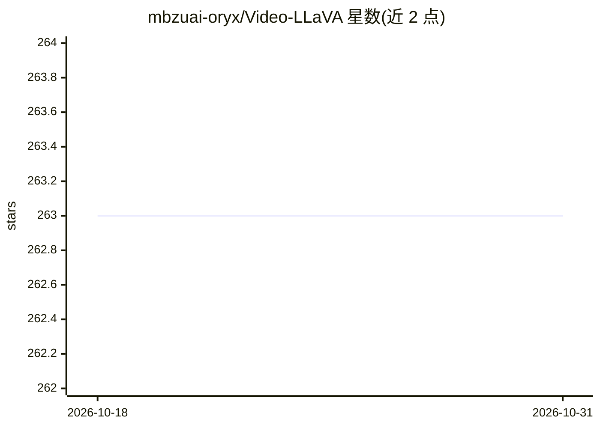

# mbzuai-oryx/Video-LLaVA

⭐ 263 · Python · 推送 2026-09-05 · [GitHub](https://github.com/mbzuai-oryx/Video-LLaVA) · [官网](https://mbzuai-oryx.github.io/Video-LLaVA) · 组织维护

**带像素级定位能力的视频多模态大模型（研究代码与模型）**

MBZUAI 团队发布的视频大型多模态模型（LMM），在对话式视频理解之上增加像素级 grounding：借助现成跟踪器与新增 grounding 模块，按用户指令在视频中空间定位对象；引入音频上下文以覆盖对话、新闻等音频信号重要的场景。附带新提出的 grounding 评测基准，并以开源 Vicuna（替代 GPT-3.5）保证评测可复现。README 提供安装/CLI demo、训练与评测指引的外链，代码与模型于 2023-12 发布，配套 ArXiv 论文 2311.13435。基于 Video-ChatGPT 前作并采用 LLaVA 启发的架构。

## 筛选速览

| 维度 | 判定 | 备注 |
|---|---|---|
| AI 角色 | `ai-native` | 本体是模型或模型工具 |
| 许可风险 | `none` | — |
| 部署形态 | `None` |  |
| 模型依赖 | — | README 未给出锁定关系 |
| 硬件要求 | — | 无带数字的原话,不猜 |
| 安装摩擦 | `low` | 无编译、无系统依赖或容器化 |
| 成熟度 | — | 结构信号不足 |

## 能力要点

- 像素级视频 grounding：跟踪器+grounding 模块按指令定位对象
- 引入音频模态增强视频理解
- 提出基于 VidSTG/HC-STVG 派生的 grounding 评测基准
- 评测管线使用开源 Vicuna-13b-v1.5 替代 GPT-3.5

## 适用场景

- 我想让模型在视频中按指令定位并跟踪特定对象
- 做视频问答与对话式视频理解的科研实验
- 复现视频 grounding 与零样本 QA 基准评测

## 场景标签

`多模态` `科研工具` `模型评测` · 领域:评测与运维

## 证据(README 行号)

> L17: PG-Video-LLaVA is the first video-based Large Multimodal Model (LMM) with pixel-level grounding capabilities. 🔥🔥🔥
> L25: - We propose PG-Video-LLaVA, **the first video-based LMM with pixel-level grounding capabilities**, featuring a mod

## 星数曲线

2026-10-18 263 → 2026-10-31 263（+0）

---
*卡片 v1 · prompt 1.4 · 生成 2026-10-22 · 置信度 high · 依据 README sha `208a2fed16dc` · [字段定义](../../DATASET.md)*
