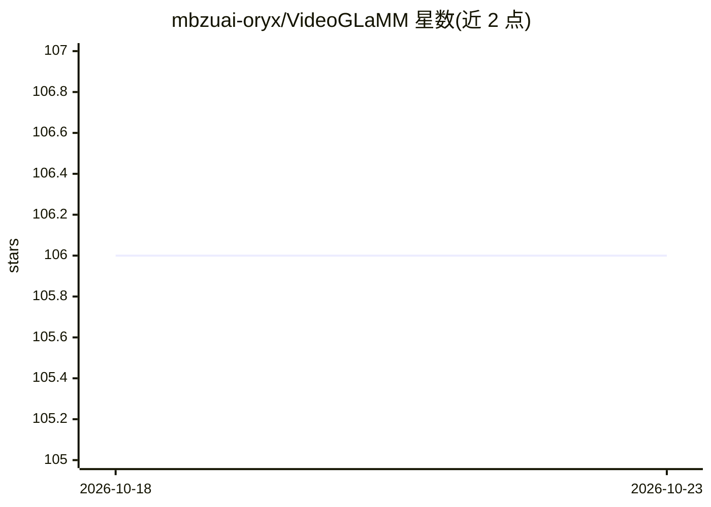

# mbzuai-oryx/VideoGLaMM

⭐ 106 · Python · 推送 2026-09-05 · [GitHub](https://github.com/mbzuai-oryx/VideoGLaMM) · [官网](https://mbzuai-oryx.github.io/VideoGLaMM/) · 组织维护

**视频像素级视觉定位的大多模态模型（CVPR 2025）**

VideoGLaMM 是面向视频理解的大型多模态模型，响应用户自然语言查询，在文本回答中嵌入时空对象掩码实现像素级视觉定位。架构连接 LLM、双视觉编码器（分别提取空间与时间特征）和可提示像素解码器，在自建的 Grounded Conversation Generation（GCG）视频数据集（38k 视频问答三元组、约 671k 细粒度掩码）上端到端训练。提供 conda/pip 环境搭建与训练评估指引，需编译 SAM2 组件。

## 筛选速览

| 维度 | 判定 | 备注 |
|---|---|---|
| AI 角色 | `ai-native` | 本体是模型或模型工具 |
| 许可风险 | `none` | — |
| 部署形态 | `library` | 以包/库形式分发 |
| 模型依赖 | — | README 未给出锁定关系 |
| 硬件要求 | — | 无带数字的原话,不猜 |
| 安装摩擦 | `high` | 编译与系统依赖俱全 |
| 成熟度 | — | 结构信号不足 |

## 能力要点

- 自然语言查询下生成带像素级掩码定位的视频文本回答
- LLM + 双视觉编码器 + 时空像素解码器三组件架构
- GCG 视频数据集：38k 视频-问答三元组、约 671k 细粒度时空掩码
- 半自动标注管线构建 grounded conversation 数据集

## 适用场景

- 对视频内容做带像素级定位的对话式问答
- grounded conversation generation、视觉定位与指代视频分割研究
- 作为视频多模态模型研究的基线复现与评测

## 场景标签

`多模态` `目标检测` · 领域:感知与多模态

## 证据(README 行号)

> L19: VideoGLaMM is a large video multimodal video model capable of pixel-level visual grounding. The model responds to n
> L32: VideoGLaMM consists of following key components: (i) Spatio-Temporal Dual Encoder, (ii) Dual Alignment V-L Adapters

## 星数曲线

2026-10-18 106 → 2026-10-23 106（+0）

---
*卡片 v1 · prompt 1.4 · 生成 2026-10-23 · 置信度 high · 依据 README sha `e90e836a1006` · [字段定义](../../DATASET.md)*
