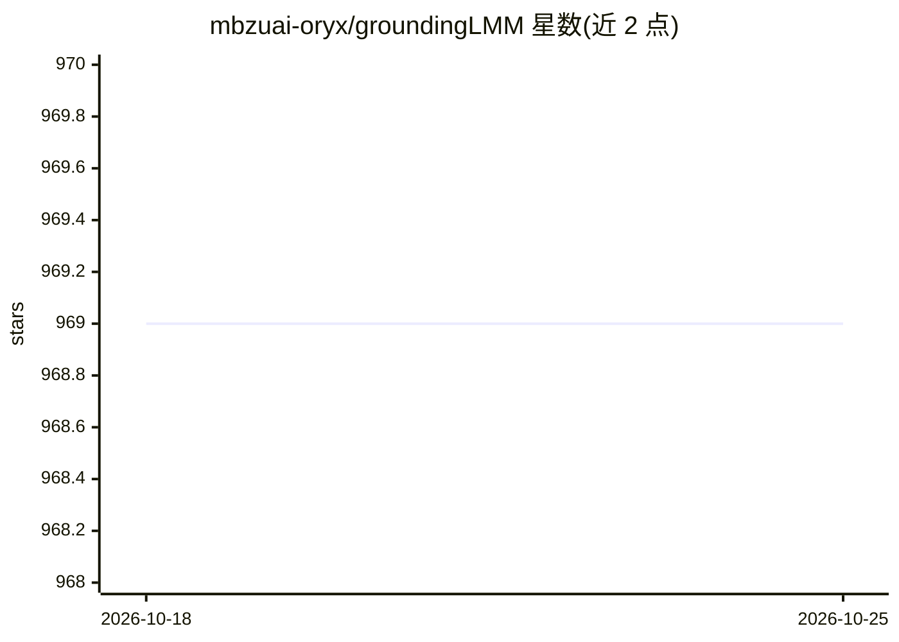

# mbzuai-oryx/groundingLMM

⭐ 969 · Python · Apache-2.0 · 推送 2026-09-05 · [GitHub](https://github.com/mbzuai-oryx/groundingLMM) · [官网](https://grounding-anything.com) · 组织维护

**像素级视觉定位大模型：生成对话并输出分割掩码**

CVPR 2024 论文 GLaMM 的官方代码库，由 MBZUAI 等机构团队维护。GLaMM 是端到端训练的大型多模态模型，支持图像与区域级输入，提出 Grounded Conversation Generation（GCG）任务：生成自然语言回答并与目标分割掩码集成。配套发布 GranD 数据集（7.5M 概念、810M 区域，含自动标注管线）、GranD-f 微调集（约 214K 图文对），提供训练、评测代码与预训练检查点，下游支持指代表达分割、区域级描述与图像描述。安装需自建 conda 环境。

## 筛选速览

| 维度 | 判定 | 备注 |
|---|---|---|
| AI 角色 | `ai-native` | 本体是模型或模型工具 |
| 许可风险 | `permissive` | Apache-2.0 |
| 部署形态 | `None` |  |
| 模型依赖 | — | README 未给出锁定关系 |
| 硬件要求 | — | 无带数字的原话,不猜 |
| 安装摩擦 | `low` | 无编译、无系统依赖或容器化 |
| 成熟度 | — | 结构信号不足 |

## 能力要点

- 提出 GCG 任务：短语定位+指代分割+视觉对话统一
- GranD 大规模数据集与自动标注管线（7.5M 概念/810M 区域）
- 提供训练、评测代码与预训练检查点
- 下游支持指代表达分割、区域级描述、图像描述

## 适用场景

- 研究生成带分割掩码的视觉对话输出
- 复现 GCG 训练评测或微调模型
- 获取区域级理解与指代分割的预训练模型

## 场景标签

`多模态` `模型训练` `目标检测` · 领域:感知与多模态

## 证据(README 行号)

> L26: Grounding Large Multimodal Model (GLaMM) is an end-to-end trained LMM which provides visual grounding capabilities 
> L30: - **GLaMM Introduction.** We present the Grounding Large Multimodal Model (GLaMM), the first-of-its-kind model capa

## 星数曲线

2026-10-18 969 → 2026-10-25 969（+0）

---
*卡片 v1 · prompt 1.4 · 生成 2026-10-21 · 置信度 high · 依据 README sha `8b354b54529f` · [字段定义](../../DATASET.md)*
