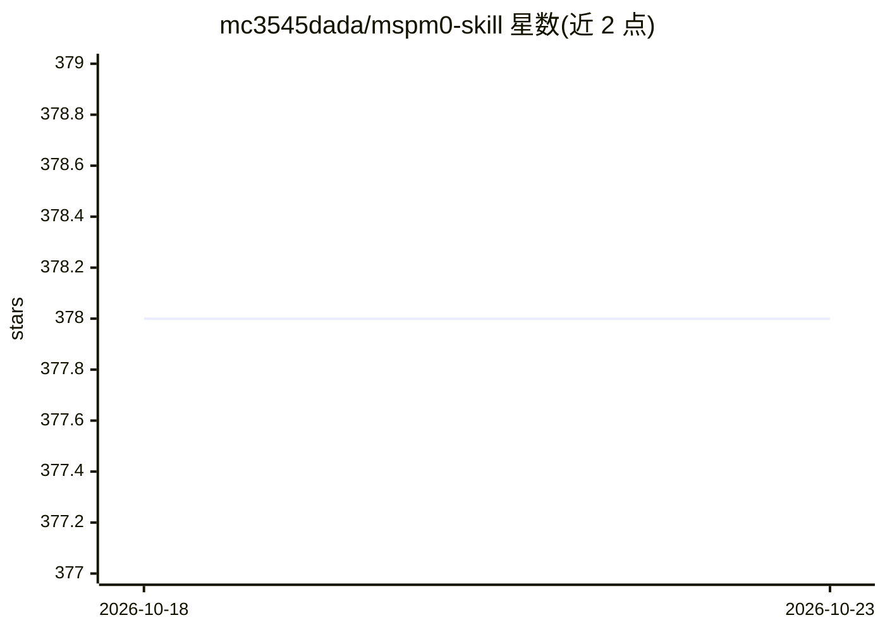

# mc3545dada/mspm0-skill

⭐ 378 · Python · MIT · 推送 2026-07-28 · [GitHub](https://github.com/mc3545dada/mspm0-skill) · 个人维护 · 中文 README

**让 AI Agent 参与 MSPM0 嵌入式开发与电赛备赛的技能包**

一组经真实板级验证的 Agent Skill 规则、脚本与例程，面向 MSPM0 微控制器开发与电赛备赛，适用于 Claude Code、Codex、Cursor 等 CLI/编辑器 Agent。能力包括检查修改 .syscfg（保留时钟树、PinMux、DMA 等配置）、识别 CCS/Keil/CMake 工具链、固化构建烧录工作流（DSLite/J-Link/OpenOCD）、CCS-DSS 与 OpenOCD/GDB 两条硬件调试链路、串口闭环验证及锁定诊断恢复引导。附带 Python 辅助脚本与 6 个内置例程；SDK、CCS 等开发工具不随 skill 自动安装，需用户自行准备。

## 筛选速览

| 维度 | 判定 | 备注 |
|---|---|---|
| AI 角色 | `ai-ecosystem` | LLM/agent 周边工具 |
| 许可风险 | `permissive` | MIT |
| 部署形态 | `library` | 以包/库形式分发 |
| 模型依赖 | — | README 未给出锁定关系 |
| 硬件要求 | — | 无带数字的原话,不猜 |
| 安装摩擦 | `medium` | 含编译或系统依赖之一 |
| 成熟度 | — | 结构信号不足 |

## 能力要点

- 检查/修改 .syscfg 并保留 metadata、时钟树、PinMux、DMA 与中断配置
- 固化 SysConfig CLI、gmake、TI Arm Clang、CMake、DSLite/J-Link、OpenOCD 构建烧录工作流
- CCS-DSS 与 OpenOCD/GDB 两条硬件调试链路
- 芯片锁定诊断与 UART BSL、DSSM Mass Erase、Factory Reset 恢复引导

## 适用场景

- 电赛备赛中让 Agent 直接修改 SysConfig 配置并构建烧录
- 现有 MSPM0 工程的板级调试与串口 PID 参数调试
- 新项目从空工程到点灯、UART 例程的快速起步

## 场景标签

`提示工程` · 领域:Agent 开发

## 证据(README 行号)

> L3: **让 AI Agent 真正参与 MSPM0 的 SysConfig 配置、工程构建、烧录与调试。**
> L12: 面向MSPM0 开发与电赛备赛，适用于 Claude Code、Codex、OpenCode、OpenClaw、Continue、Cursor 等 CLI / 编辑器 Agent。这是一组经过真实项目验证的规则、脚本、例程和调试 

## 星数曲线

2026-10-18 378 → 2026-10-23 378（+0）

---
*卡片 v1 · prompt 1.4 · 生成 2026-10-21 · 置信度 mid · 依据 README sha `7a1be562777e` · [字段定义](../../DATASET.md)*
