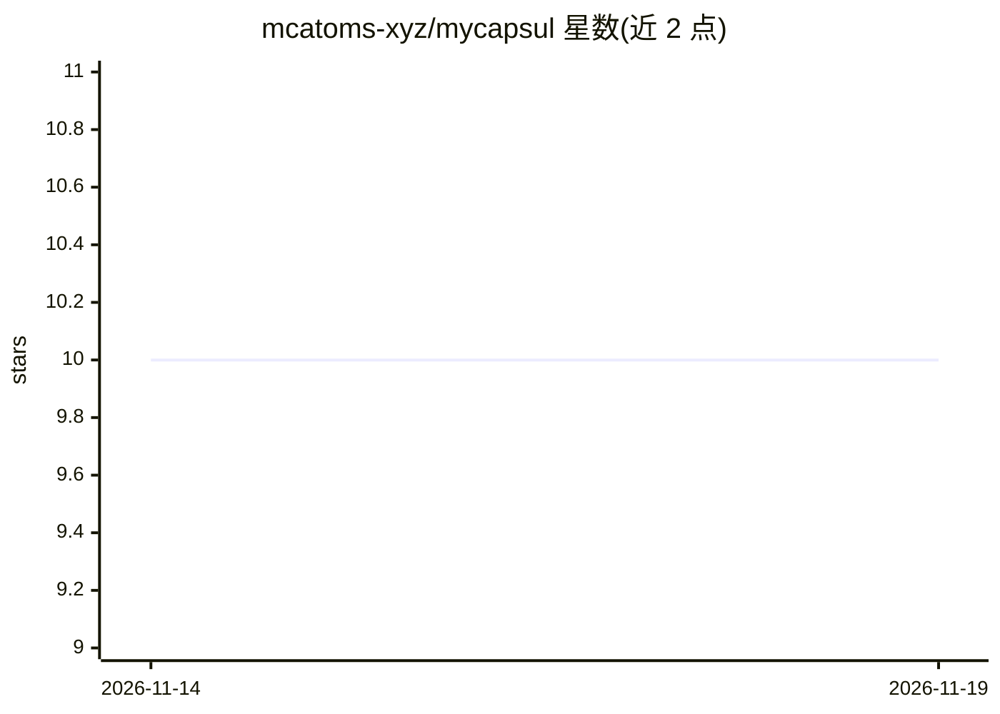

# mcatoms-xyz/mycapsul

⭐ 10 · HTML · 推送 2026-09-04 · [GitHub](https://github.com/mcatoms-xyz/mycapsul) · [官网](https://mycapsul.com) · 个人维护

**给 Claude Desktop 用户的个人生活仪表盘插件**

MyCapsul 是一个安装于 Claude Desktop（Cowork 模式）的插件：Agent 在用户对话过程中维护日程、财务、目标、健康、法律事务等数据，并生成可视化仪表盘。仪表盘为单文件 HTML（约 6100 行，CSS/JS 内联，无构建工具），使用 localStorage+IndexedDB 双层持久化，数据留在本地；新闻、天气等实时磁贴需调用第三方服务。安装方式为下载 Releases 中的 zip，在 Cowork 会话中解压并经 5 步向导完成设置。

## 筛选速览

| 维度 | 判定 | 备注 |
|---|---|---|
| AI 角色 | `ai-enhanced` | 去掉 AI 部分产品仍成立 |
| 许可风险 | `none` | — |
| 部署形态 | `desktop` | 安装包/桌面程序 |
| 模型依赖 | — | README 未给出锁定关系 |
| 硬件要求 | — | 无带数字的原话,不猜 |
| 安装摩擦 | `low` | 无编译、无系统依赖或容器化 |
| 成熟度 | — | 结构信号不足 |

## 能力要点

- Agent 在对话中自动维护日程/财务/目标/健康等仪表盘数据
- 数据存本地（localStorage+IndexedDB），无云无账号
- 单文件 HTML 仪表盘，无构建工具，含 Chart.js 图表
- 5 步浏览器向导完成设置，支持自动同步或一键导出

## 适用场景

- 在 Claude Desktop 对话中维护个人日程与财务预算
- ADHD 管理与能量追踪、医疗记录
- 家庭场景：学校事件、成绩与活动管理
- 法律事务：文档追踪与庭审日期准备

## 场景标签

`AI 助手` `Agent 记忆` · 领域:Agent 开发

## 证据(README 行号)

> L3: **A personal life dashboard plugin for Claude Desktop by Anthropic.**
> L20: A plugin for Claude Desktop (Cowork mode). Install it and Claude keeps a dashboard of your life current as you talk

## 星数曲线

2026-11-14 10 → 2026-11-19 10（+0）

---
*卡片 v1 · prompt 1.4 · 生成 2026-11-19 · 置信度 high · 依据 README sha `53b00cd0c48c` · [字段定义](../../DATASET.md)*
