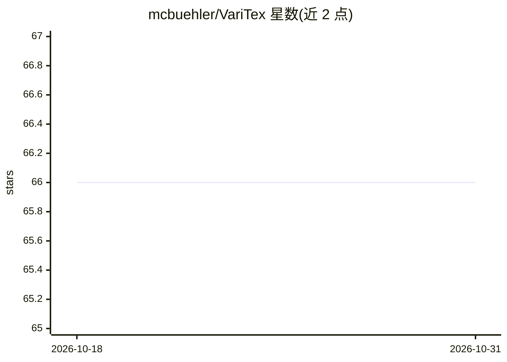

# mcbuehler/VariTex

⭐ 66 · Jupyter Notebook · 推送 2026-01-02 · [GitHub](https://github.com/mcbuehler/VariTex) · [官网](https://mcbuehler.github.io/VariTex/) · 个人维护

**ICCV 2021 人脸纹理变分生成模型：合成可控人脸图像**

论文 VariTex: Variational Neural Face Textures（ICCV 2021）的官方代码仓库。方法学习人脸神经纹理的变分潜空间，结合参数化人脸模型（BFM），可显式控制头部姿态、脸型与表情，并用加性解码器生成头发等细节；支持新身份采样、重姿态化、表情迁移。以 PyTorch/Lightning 实现，提供预训练模型、demo notebook 与推理/训练脚本；训练在 FFHQ 数据集与 BFM 上进行，需下载数据并配置环境变量，许可为 CC BY-NC-SA 4.0。

## 筛选速览

| 维度 | 判定 | 备注 |
|---|---|---|
| AI 角色 | `ai-native` | 本体是模型或模型工具 |
| 许可风险 | `none` | — |
| 部署形态 | `None` |  |
| 模型依赖 | — | README 未给出锁定关系 |
| 硬件要求 | — | 无带数字的原话,不猜 |
| 安装摩擦 | `low` | 无编译、无系统依赖或容器化 |
| 成熟度 | — | 结构信号不足 |

## 能力要点

- 变分潜空间学习人脸神经纹理，可采样新身份
- 结合 BFM 显式控制头部姿态、脸型与表情
- 提供预训练模型、demo notebook 与三种推理模式
- 加性解码器生成头发等附加细节

## 适用场景

- 用预训练模型生成可控姿态与表情的人脸图像
- 在 FFHQ 数据上复现训练流程
- 做重姿态化与表情迁移等下游实验

## 场景标签

`图像生成` · 领域:内容生成

## 证据(README 行号)

> L10: > **VariTex: Variational Neural Face Textures**
> L12: > **Abstract:** *Deep generative models have recently demonstrated the ability to synthesize photorealistic images 

## 星数曲线

2026-10-18 66 → 2026-10-31 66（+0）

---
*卡片 v1 · prompt 1.4 · 生成 2026-10-24 · 置信度 high · 依据 README sha `ccd5f82a1e86` · [字段定义](../../DATASET.md)*
