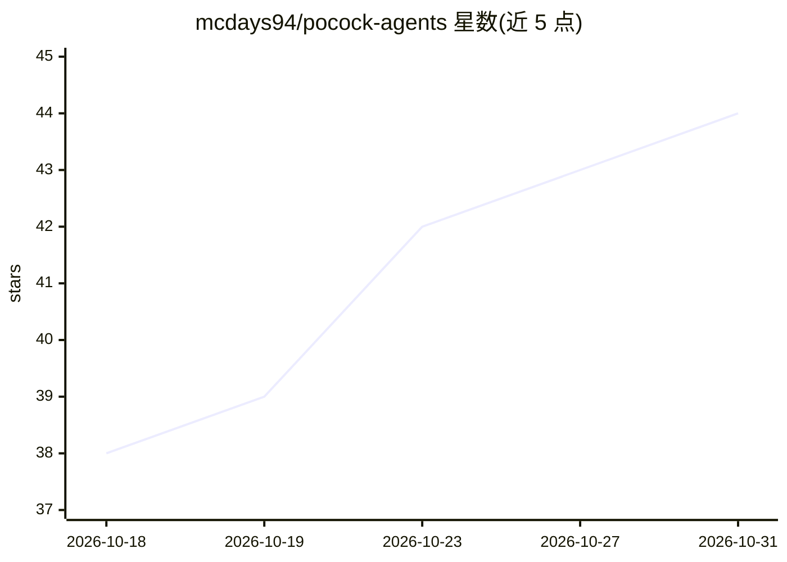

# mcdays94/pocock-agents

⭐ 44 · Shell · MIT · 推送 2026-09-30 · [GitHub](https://github.com/mcdays94/pocock-agents) · 个人维护

**在 OpenCode 中运行 Matt Pocock 技能流的两个 agent 定义**

由两个 Markdown agent 文件（编排者与实现者）组成，将 Matt Pocock 的技能驱动工程流程接入 OpenCode：通过 grilling 问答打磨想法，生成 spec 与 tickets，再由编排者为每个 ticket 创建 git worktree 并以并行 worker 按 TDD 实现，随后 code-review、起草 PR 并做 retro。依赖 OpenCode（测试于 v1.18.33）与 mattpocock/skills 技能包，通过 curl 下载或克隆仓库软链安装；上游技能更名会导致失效，提供 check-skills.sh 脚本与每周 CI 检查，并含 Docker 冒烟测试。

## 筛选速览

| 维度 | 判定 | 备注 |
|---|---|---|
| AI 角色 | `ai-ecosystem` | LLM/agent 周边工具 |
| 许可风险 | `permissive` | MIT |
| 部署形态 | `self-host` | docker 或自建部署 |
| 模型依赖 | — | README 未给出锁定关系 |
| 硬件要求 | — | 无带数字的原话,不猜 |
| 安装摩擦 | `low` | 无编译、无系统依赖或容器化 |
| 成熟度 | — | 结构信号不足 |

## 能力要点

- 编排者/worker 模式：每 ticket 独立 git worktree 并行实现
- 覆盖 grill→spec→tickets→build→review→retro 完整流程
- check-skills.sh 与每周 GitHub Action 检测上游技能更名
- Docker 冒烟测试含确定性检查与完整模型运行两种模式

## 适用场景

- 在 OpenCode 里跑 Matt Pocock 的技能化开发流程
- 把一个想法自动拆成 spec 与可并行开发的 tickets
- 按 TDD 在隔离 worktree 中并行实现多个 ticket 并自动审查合并

## 场景标签

`编码 Agent` `代码审查` · 领域:编码与开发

## 证据(README 行号)

> L3: Two OpenCode agents that run Matt Pocock's skill-driven engineering flow end to end: grill an idea until it's sharp,
> L13: |`agents/pocock.md`|**Orchestrator** (primary agent). Routes with Matt's `ask-matt`, walks the flow phase by phase,
> L14: |`agents/pocock-worker.md`|**Implementer** (subagent). Takes one ticket and a prepared worktree, builds it with `td

## 星数曲线

2026-10-18 38 → 2026-10-31 44（+6）

---
*卡片 v1 · prompt 1.4 · 生成 2026-10-25 · 置信度 mid · 依据 README sha `9676b38e1acf` · [字段定义](../../DATASET.md)*
