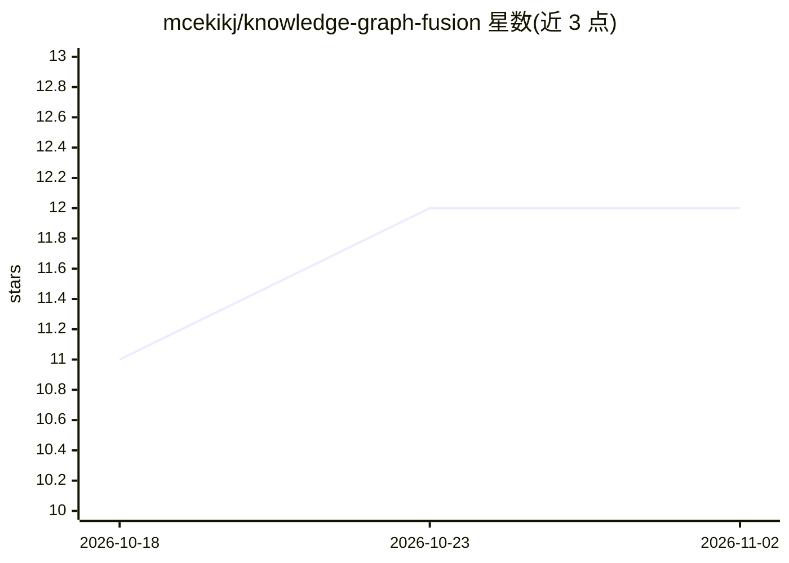

# mcekikj/knowledge-graph-fusion

⭐ 12 · Python · MIT · 推送 2026-07-21 · [GitHub](https://github.com/mcekikj/knowledge-graph-fusion) · 个人维护

**持久知识层：双时序知识图谱上的始终融合检索与有界 agent 问答**

基于 FastAPI 的持久知识层系统（系列第 2/3 部分）：每次查询同时执行混合搜索与有界类型化图遍历（Gremlin + 内存图引擎），联合重排并携带关系路径作为证据；边带双时态（有效期+摄入时间），矛盾在摄入时检测且不自动裁决，实体消解为双阈值流程（嵌入分块+灰区 LLM 仲裁）。第 3 部分在同一层上叠加有界 agent（八个只读 MCP 形工具、工具轮/Token/时间硬上限）与 gpt-4/gpt-5 模型族适配。本地无 Azure 即可运行，Azure 模式经 Bicep 部署全套托管资源（免密钥托管身份）；语料为合成保险演示数据。

## 筛选速览

| 维度 | 判定 | 备注 |
|---|---|---|
| AI 角色 | `ai-native` | 本体是模型或模型工具 |
| 许可风险 | `permissive` | MIT |
| 部署形态 | `library` | 以包/库形式分发 |
| 模型依赖 | — | README 未给出锁定关系 |
| 硬件要求 | — | 无带数字的原话,不猜 |
| 安装摩擦 | `low` | 无编译、无系统依赖或容器化 |
| 成熟度 | — | 结构信号不足 |

## 能力要点

- 始终融合检索：混合搜索+有界类型图遍历，联合重排带关系路径证据
- 双时态边（有效期+摄入时间）与 as_of 时点作用域查询
- 摄入时矛盾检测：返回双方陈述、指明 owner、不代为裁决
- 双阈值实体消解（嵌入分块+灰区 LLM 仲裁）；第 3 部分为有界 agent（8 个只读工具+矛盾门控）

## 适用场景

- 需要按生效日期回溯历史规则适用性的领域问答
- 检测并登记文档间矛盾而非静默选边的知识管理
- 对比固定融合流水线与 agent 问答的成本/质量权衡
- 在 Azure 上以无密钥托管身份部署图增强 RAG 层

## 场景标签

`知识图谱` `RAG` · 领域:知识与检索

## 证据(README 行号)

> L5: The second iteration of the persistent knowledge layer: the query router is retired in favor of an **always-fused re
> L39: A RAG evidence layer grounds answers in source documents. A **knowledge layer** beside it accumulates what the syst
> L115: |`POST /agent/query`|**(Part 3)** The bounded agent over the typed tool surface: `{ question, as_of, toolset, poli

## 星数曲线

2026-10-18 11 → 2026-11-02 12（+1）

---
*卡片 v1 · prompt 1.4 · 生成 2026-11-01 · 置信度 mid · 依据 README sha `1124a16ac86e` · [字段定义](../../DATASET.md)*
