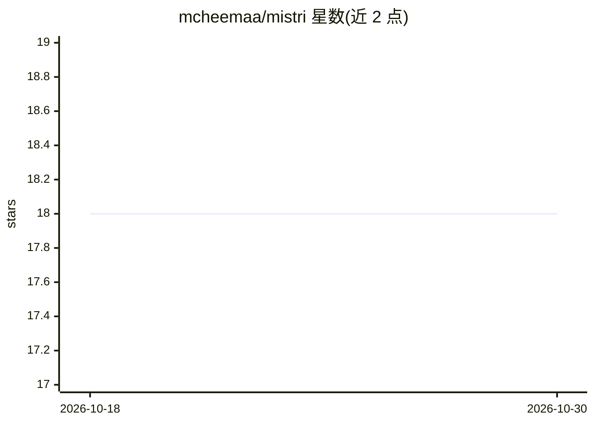

# mcheemaa/mistri

⭐ 18 · Ruby · MIT · 推送 2026-09-14 · [GitHub](https://github.com/mcheemaa/mistri) · [官网](https://mistri.sh) · 个人维护

**Ruby 应用的 AI agent 框架：托管 agent 循环与持久会话**

在 Ruby/Rails/Sinatra/Hanami 应用内运行 AI agent 的 gem：提供持久会话（append-only 日志可跨进程恢复、数天后续跑）、人工审批门控、流式事件输出（SSE/ActionCable）、上下文压缩、结构化输出、子 agent 与 MCP 客户端。通过原生协议接入 Anthropic、OpenAI、Gemini 三家 provider，零运行时 gem 依赖，Ruby 3.2+。处于 pre-1.0 阶段，小版本可能包含契约变更。

## 筛选速览

| 维度 | 判定 | 备注 |
|---|---|---|
| AI 角色 | `ai-ecosystem` | LLM/agent 周边工具 |
| 许可风险 | `permissive` | MIT |
| 部署形态 | `None` |  |
| 模型依赖 | locked-api |  |
| 硬件要求 | — | 无带数字的原话,不猜 |
| 安装摩擦 | `low` | 无编译、无系统依赖或容器化 |
| 成熟度 | `idea` | |

## 能力要点

- 持久会话：崩溃/中止后可恢复，审批决策可来自不同进程
- 人工审批门控：工具调用可暂停等待批准后继续
- MCP 客户端（Streamable HTTP/stdio）与子 agent 委派
- 零运行时 gem 依赖，支持 Ruby 3.2+

## 适用场景

- 在 Rails 应用中嵌入带人工审批的 agent 工作流
- 长对话任务的上下文压缩与结构化 JSON 输出
- 通过 MCP 接入外部工具并对调用施加本地验证与审批

## 场景标签

`Agent 框架` `Agent 记忆` · 领域:Agent 开发

## 证据(README 行号)

> L14: Mistri runs AI agents inside your own Ruby application, on your models, your
> L29:  Anthropic, OpenAI, and Gemini, each through its own native protocol.

## 星数曲线

2026-10-18 18 → 2026-10-30 18（+0）

---
*卡片 v1 · prompt 1.4 · 生成 2026-10-29 · 置信度 high · 依据 README sha `ee146ec89eb3` · [字段定义](../../DATASET.md)*
