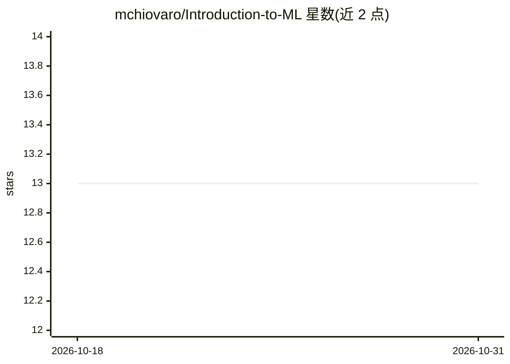

# mchiovaro/Introduction-to-ML

⭐ 13 · Jupyter Notebook · 推送 2026-04-08 · [GitHub](https://github.com/mchiovaro/Introduction-to-ML) · 个人维护

**面向工程师的机器学习入门课程 notebooks（10 讲）**

由个人作者（Megan Chiovaro, PhD）维护的机器学习入门教程仓库，以 Jupyter notebooks 形式提供，主题覆盖数据准备与特征工程、线性回归、kNN/逻辑回归/决策树/SVM/随机森林、聚类、神经网络（从零实现前向传播与反向传播）及梯度下降变体、模型部署等。使用方式为下载 notebooks 后在 Google Colab 中打开并跟随编码，部分 notebook 附练习答案。面向工程师背景的学习者，不提供打包安装或服务。

## 筛选速览

| 维度 | 判定 | 备注 |
|---|---|---|
| AI 角色 | `ai-knowledge` | 知识聚合/清单类 |
| 许可风险 | `none` | — |
| 部署形态 | `None` |  |
| 模型依赖 | — | README 未给出锁定关系 |
| 硬件要求 | — | 无带数字的原话,不猜 |
| 安装摩擦 | `low` | 无编译、无系统依赖或容器化 |
| 成熟度 | — | 结构信号不足 |

## 能力要点

- 10 个主题 notebook 覆盖从数据准备到模型部署
- 从零实现单层神经网络（前向/反向传播）与三种梯度下降变体
- 决策树实验提供 outline/scratch/答案三个版本

## 适用场景

- 工程师背景学习者系统入门机器学习
- 在 Google Colab 中跟随编码实践回归、分类、聚类与神经网络
- 课堂或自学时使用配套练习与答案 notebook

## 场景标签

`教程课程` · 领域:学习与行业

## 证据(README 行号)

> L3: _An Introductory Course on Machine Learning, Tailored Toward Engineers_
> L5: **Welcome!** This course provides and introduction to Machine Learning and it's use across various engineering domai

## 星数曲线

2026-10-18 13 → 2026-10-31 13（+0）

---
*卡片 v1 · prompt 1.4 · 生成 2026-10-31 · 置信度 high · 依据 README sha `9e06e6db705b` · [字段定义](../../DATASET.md)*
