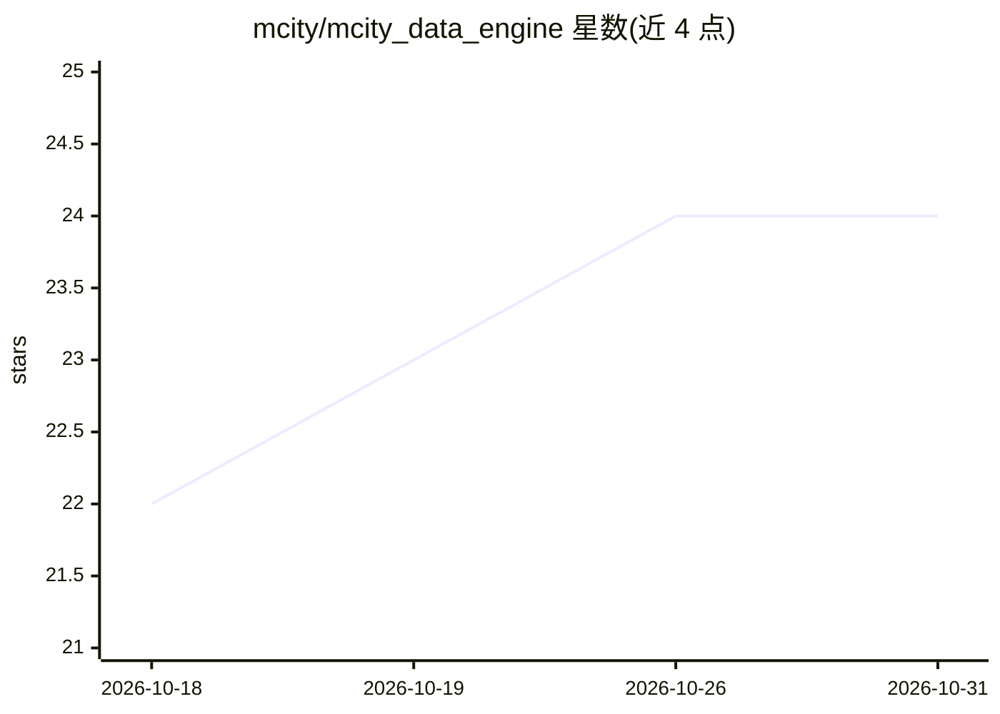

# mcity/mcity_data_engine

⭐ 24 · Python · MIT · 推送 2026-08-21 · [GitHub](https://github.com/mcity/mcity_data_engine) · [官网](https://mcity.umich.edu/what-we-do/data-for-ai/) · 组织维护

**面向交通领域视觉 AI 的数据整理与模型迭代训练框架**

密歇根大学 Mcity 维护的数据引擎，覆盖从原始视觉数据出发持续改进 AI 模型的各阶段：基于嵌入的数据选择（代表性样本与稀有样本识别）、弱势道路使用者检测的模型训练，配合 Voxel51 可视化、Weights & Biases 实验记录与 Hugging Face 模型托管。许多工作流需要至少一块 GPU；以 git clone 加 requirements 安装从源码运行，提供 Google Colab 在线演示（能力受限）。有 ITSC 2025 论文。

## 筛选速览

| 维度 | 判定 | 备注 |
|---|---|---|
| AI 角色 | `ai-ecosystem` | LLM/agent 周边工具 |
| 许可风险 | `permissive` | MIT |
| 部署形态 | `library` | 以包/库形式分发 |
| 模型依赖 | — | README 未给出锁定关系 |
| 硬件要求 | — | 无带数字的原话,不猜 |
| 安装摩擦 | `medium` | 含编译或系统依赖之一 |
| 成熟度 | — | 结构信号不足 |

## 能力要点

- 基于模型嵌入的数据选择工作流（代表性/稀有样本）
- 训练过程通过 WandB 记录、模型托管于 Hugging Face
- Voxel51 会话可视化数据集与样本选择结果
- 面向交通场景（如 Fisheye8K、VRU 检测）的模型迭代训练

## 适用场景

- 对大规模视觉数据集做嵌入选择与数据整理
- 迭代训练改进道路使用者检测模型
- 在 Colab 中体验数据选择工作流（受限版）

## 场景标签

`模型训练` `目标检测` · 领域:感知与多模态

## 证据(README 行号)

> L48: The Mcity Data Engine is an essential tool in the Mcity makerspace for transportation innovators making AI algorith
> L60: To get a first feel for the Mcity Data Engine, we provide an online demo in a Google Colab environment. We will loa
> L69: At least one GPU is required for many of the Mcity Data Engine workflows. Check the hardware setups we have tested 

## 星数曲线

2026-10-18 22 → 2026-10-31 24（+2）

---
*卡片 v1 · prompt 1.4 · 生成 2026-10-27 · 置信度 mid · 依据 README sha `04605b9ddabb` · [字段定义](../../DATASET.md)*
