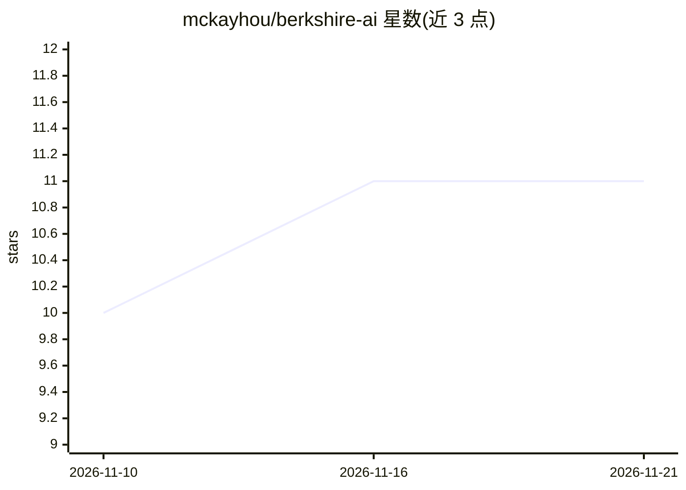

# mckayhou/berkshire-ai

⭐ 11 · Python · MIT · 推送 2026-09-01 · [GitHub](https://github.com/mckayhou/berkshire-ai) · 个人维护 · 中文 README

**面向 Agent 运行时的四大师并行 AI 投研系统**

整合自 xbtlin/ai-berkshire 的多 agent 投研框架：以段永平/巴菲特/芒格/李录四个视角并行研究标的，叠加本地 TextGrad 自进化引擎（18 变量节点、5 层计算图、文本梯度反传）与 18 个 SKILL.md 技能、确定性金融工具链（Decimal 计算、Benford 检验、三情景估值）。设计为在 OpenClaw/QwenPaw 类 Agent 运行时中以技能形式激活，也支持以 Python CLI、FastAPI 服务方式直接运行；A股数据走多源降级链，报告经 Telegram/飞书等通道交付。

## 筛选速览

| 维度 | 判定 | 备注 |
|---|---|---|
| AI 角色 | `ai-native` | 本体是模型或模型工具 |
| 许可风险 | `permissive` | MIT |
| 部署形态 | `self-host` | docker 或自建部署 |
| 模型依赖 | — | README 未给出锁定关系 |
| 硬件要求 | — | 无带数字的原话,不猜 |
| 安装摩擦 | `low` | 无编译、无系统依赖或容器化 |
| 成熟度 | — | 结构信号不足 |

## 能力要点

- 四大师并行视角 + 多空辩论 + 决策后验评分反馈闭环
- TextGrad 自进化引擎：显式计算图、节点级文本梯度反向传播、验证门控改写
- 18 个可移植 SKILL.md 技能，适配 OpenClaw/QwenPaw Agent 运行时
- A股多源降级数据链（native→tushare→efinance→akshare→baostock→yfinance）与确定性金融工具

## 适用场景

- 让 Agent 对指定股票（如 0700.HK、600519）运行四大师投研并生成报告
- 通过 CLI/Cron 定时执行投研主链路与进化循环
- 将引擎以带鉴权/限流的 HTTP 服务部署（/score /debate）
- 对投研关键数字做金融严谨性验证与交叉核验

## 场景标签

`多智能体` `金融量化` · 领域:Agent 开发

## 证据(README 行号)

> L5: > 叠加本地 **V10 TextGrad 自进化引擎**（显式计算图 + 节点级文本梯度反向传播 + 针对性优化）
> L14: **重要**：用户明确说明 **不在 Claude Code 中使用**，而是在 **OpenClaw / QwenPaw 这一类 AI Agent 产品/运行时**中使用。
> L26: **四大师并行视角**:

## 星数曲线

2026-11-10 10 → 2026-11-21 11（+1）

---
*卡片 v1 · prompt 1.4 · 生成 2026-11-18 · 置信度 high · 依据 README sha `6fa750fee8fd` · [字段定义](../../DATASET.md)*
