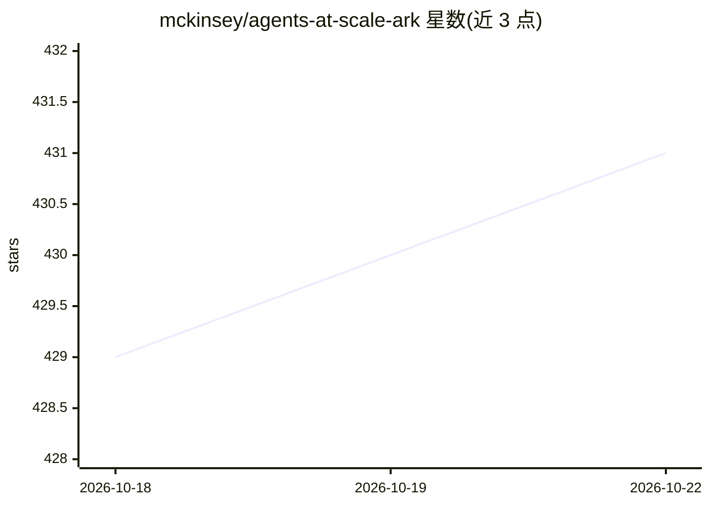

# mckinsey/agents-at-scale-ark

⭐ 431 · TypeScript · Apache-2.0 · 推送 2026-10-21 · [GitHub](https://github.com/mckinsey/agents-at-scale-ark) · [官网](https://mckinsey.github.io/agents-at-scale-ark/) · 组织维护

**Kubernetes 上的声明式 Agent 运行时框架，供团队构建可移植 agentic 应用**

麦肯锡开源的 Agentic Runtime for Kubernetes：以 Kubernetes 自定义资源声明式定义 agent（提示词、工具、模型引用），由控制器与仪表盘承载运行。支持多 agent 编排（顺序/图/选择/轮询）、HTTP API 与 MCP 工具接入、可插拔持久记忆、A2A 协议互操作，并提供 CLI 与 Python/TypeScript SDK。可在单机本地集群或多云/本地 Kubernetes 环境运行，需 Node.js、Helm 与 Kubernetes 集群。Apache 2.0 许可。

## 筛选速览

| 维度 | 判定 | 备注 |
|---|---|---|
| AI 角色 | `ai-ecosystem` | LLM/agent 周边工具 |
| 许可风险 | `permissive` | Apache-2.0 |
| 部署形态 | `library` | 以包/库形式分发 |
| 模型依赖 | local-ok | 支持本地模型 |
| 硬件要求 | — | 无带数字的原话,不猜 |
| 安装摩擦 | `low` | 无编译、无系统依赖或容器化 |
| 成熟度 | — | 结构信号不足 |

## 能力要点

- 以 Kubernetes 自定义资源声明式定义 agent
- 可切换 OpenAI/Anthropic/Google/Azure/本地 Ollama 而不改代码
- 多 agent 编排与 MCP/A2A 协议接入
- 提供 CLI 与 Python/TypeScript SDK

## 适用场景

- 在 Kubernetes 上部署和运维分布式多 agent 应用
- 团队以声明式规范管理 agent 避免供应商锁定
- 在单机开发环境与多云集群间迁移 agentic 工作负载

## 场景标签

`Agent 框架` `多智能体` · 领域:Agent 开发

## 证据(README 行号)

> L4:  A declarative, Kubernetes-native framework for building portable, scalable, and provider-agnostic agentic applicati
> L32: - **Declarative Agents** — Define agents as Kubernetes custom resources with prompts, tools, and model references

## 星数曲线

2026-10-18 429 → 2026-10-22 431（+2）

---
*卡片 v1 · prompt 1.4 · 生成 2026-10-22 · 置信度 mid · 依据 README sha `05ff3540f644` · [字段定义](../../DATASET.md)*
