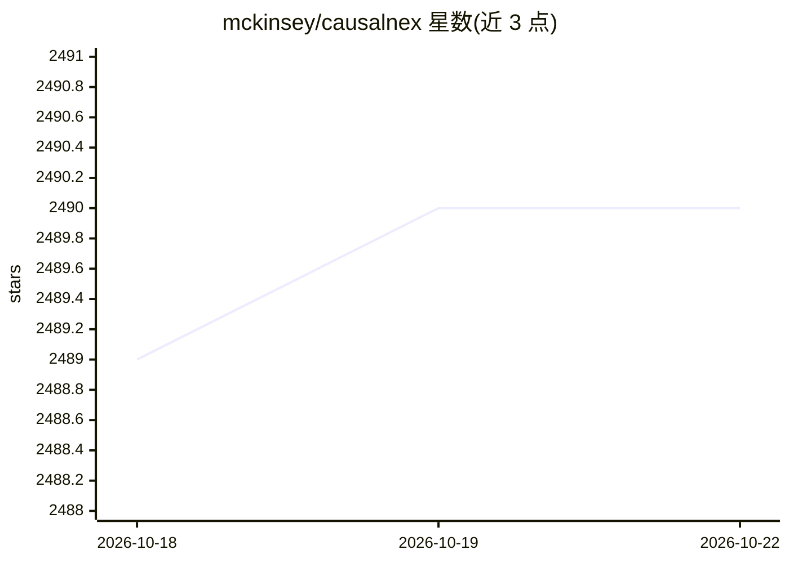

# mckinsey/causalnex

⭐ 2,490 · Python · NOASSERTION · 推送 2026-08-31 · [GitHub](https://github.com/mckinsey/causalnex) · [官网](http://causalnex.readthedocs.io/) · 组织维护

**基于贝叶斯网络的因果推断与反事实分析 Python 库（已停止维护）**

面向数据科学家的因果推理工具包：用结构学习从数据学习因果结构，允许领域专家增补图中的关系，拟合贝叶斯网络的概率分布，并基于 Do-calculus 估计干预效果与反事实影响，将原本需 3-4 个库完成的因果分析流程整合在一个端到端 Python 包中，附带可视化与统计模型检验。以 pip 安装，提供完整文档与教程。注意：项目已宣布于 2026 年 6 月 24 日终止维护，仓库仅作历史存档，不再接受更新或修复。

## 筛选速览

| 维度 | 判定 | 备注 |
|---|---|---|
| AI 角色 | `ai-native` | 本体是模型或模型工具 |
| 许可风险 | `none` | NOASSERTION |
| 部署形态 | `library` | 以包/库形式分发 |
| 模型依赖 | — | README 未给出锁定关系 |
| 硬件要求 | — | 无带数字的原话,不猜 |
| 安装摩擦 | `low` | 无编译、无系统依赖或容器化 |
| 成熟度 | — | 结构信号不足 |

## 能力要点

- 结构学习方法从数据学习变量间条件依赖与因果结构
- 支持领域知识注入/增补图模型关系
- Do-calculus 干预效果估计与反事实分析
- 将因果与反事实分析端到端流程整合进单个库

## 适用场景

- 从数据中识别因果关系而非仅观察相关性
- 结合领域专家知识构建贝叶斯网络并做 what-if 分析
- 评估特征干预的影响并选择正确干预措施

## 场景标签

 · 领域:数据科学/因果推断

## 证据(README 行号)

> L19: > "A toolkit for causal reasoning with Bayesian Networks."
> L40: - Use state-of-the-art structure learning methods to understand conditional dependencies between variables
> L46: - Analyse the impact of interventions using Do-calculus

## 星数曲线

2026-10-18 2,489 → 2026-10-22 2,490（+1）

---
*卡片 v1 · prompt 1.4 · 生成 2026-10-21 · 置信度 high · 依据 README sha `c30784ca803c` · [字段定义](../../DATASET.md)*
