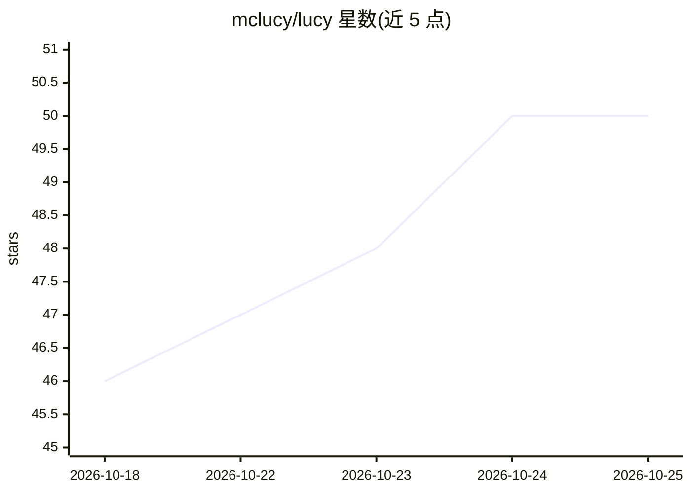

# mclucy/lucy

⭐ 50 · Go · Apache-2.0 · 推送 2026-10-24 · [GitHub](https://github.com/mclucy/lucy) · [官网](https://lucy.lc/docs) · 个人维护 · 中文 README

**Minecraft 服务器的包管理器：声明式定义并复现服务端**

用 Go 编写的 Minecraft 服务端包管理 CLI：以 lucy.yaml 声明所需组件，lucy-lock.yaml 记录精确制品与哈希，lucy install 可从锁文件复现服务器，--locked 在漂移时报错。支持 Fabric/Forge/NeoForge/MCDReforged/Bukkit 等生态，可从 Modrinth、CurseForge、GitHub 等来源获取元数据与制品，并提供跨五个目录的搜索命令。项目处于 pre-beta 阶段，API 与 schema 在 v0.1.0 前可能变动。README 未提及 AI 相关功能，尽管仓库带有 ai/ai-agents 主题标签。

## 筛选速览

| 维度 | 判定 | 备注 |
|---|---|---|
| AI 角色 | `ai-enhanced` | 去掉 AI 部分产品仍成立 |
| 许可风险 | `permissive` | Apache-2.0 |
| 部署形态 | `library` | 以包/库形式分发 |
| 模型依赖 | — | README 未给出锁定关系 |
| 硬件要求 | — | 无带数字的原话,不猜 |
| 安装摩擦 | `low` | 无编译、无系统依赖或容器化 |
| 成熟度 | `idea` | |

## 能力要点

- lucy.yaml + lucy-lock.yaml 双文件实现服务器可复现安装
- 支持 Fabric/Forge/NeoForge/MCDReforged/Bukkit 生态及其组合
- 从 Modrinth/CurseForge/GitHub 等多来源获取元数据与制品
- 跨 Modrinth/CurseForge/Hangar/Spiget/MCDReforged 目录的统一搜索

## 适用场景

- 用声明式配置管理 Minecraft 服务端的插件与模组依赖
- 通过提交锁文件让团队成员复现完全一致的服务器环境
- 在一个工具内搜索多个模组/插件目录

## 场景标签

 · 领域:游戏服务器运维/开发工具

## 证据(README 行号)

> L5: **The package manager for Minecraft servers.**
> L18: Lucy brings modern package management experience to Minecraft servers. Define and manage your server with simple an

## 星数曲线

2026-10-18 46 → 2026-10-25 50（+4）

---
*卡片 v1 · prompt 1.4 · 生成 2026-10-24 · 置信度 low · 依据 README sha `e34d423a586f` · [字段定义](../../DATASET.md)*
